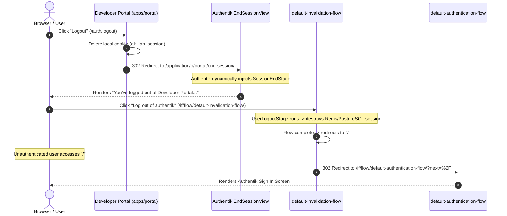

# Chapter 3 — SSR App: Authorization Code Flow

In Chapter 2, we configured Authentik with users, groups, and an OAuth2/OIDC provider. Now we build our first consumer application: **`apps/portal`**, a server-rendered web portal built with **Hono** and **Bun**.

By the end of this chapter, we have:
1. A server-side rendered application running natively with Bun and Hono JSX.
2. Complete implementation of the **Authorization Code Flow** with CSRF state verification.
3. Server-side session management using secure, signed `HttpOnly` cookies.
4. Route protection via `requireAuth()` and Role-Based Access Control via `requireGroup("lab-admins")`.
5. Federated single sign-out via Authentik's end-session endpoint.
6. A shared authentication library: **`@authentik-lab/auth`** in `packages/auth`.

---

## 3.1 — Create the `apps/portal` Hono App with JSX

### Why Server-Side Rendering (SSR) for the Portal?

Server-rendered applications (SSR) are the gold standard for confidential OAuth2 clients:
- **Zero Token Leakage to Browser**: The access token, refresh token, and client secret never touch browser JavaScript. They remain strictly on our backend server.
- **Immunity to Token Theft via XSS**: Even if an attacker injects malicious JavaScript into the page, there are no tokens in `localStorage` or `sessionStorage` for them to exfiltrate.
- **Fast First Paint**: Hono renders clean, lightweight HTML on the server and streams it instantly.

---

### App Setup

`apps/portal` is declared in our Bun monorepo:

#### `apps/portal/package.json`:
```json
{
  "name": "portal",
  "version": "1.0.0",
  "private": true,
  "scripts": {
    "dev": "bun --hot src/index.tsx"
  },
  "dependencies": {
    "@authentik-lab/auth": "workspace:*",
    "hono": "^4.13.13"
  }
}
```

#### `apps/portal/tsconfig.json`:
```json
{
  "extends": "../../tsconfig.json",
  "compilerOptions": {
    "jsx": "react-jsx",
    "jsxImportSource": "hono/jsx"
  }
}
```

---

## 3.2 — Theory: Authorization Code Flow Step-by-Step

Here is the exact lifecycle of every HTTP request, redirect, and token exchange:

```
 User Browser                     apps/portal Server                     Authentik
      │                                    │                                 │
      │ 1. Click "Sign in"                 │                                 │
      │    GET /auth/login                 │                                 │
      │───────────────────────────────────▶│                                 │
      │                                    │ 2. Generate random state        │
      │                                    │    Set signed cookie            │
      │ 3. 302 Redirect to Authentik       │                                 │
      │    /application/o/authorize/      │                                 │
      │    ?client_id=portal-client        │                                 │
      │    &redirect_uri=.../callback      │                                 │
      │    &response_type=code             │                                 │
      │    &state=<STATE>                  │                                 │
      │◀───────────────────────────────────│                                 │
      │                                                                      │
      │ 4. Authenticate & Approve Consent                                    │
      │─────────────────────────────────────────────────────────────────────▶│
      │                                                                      │
      │ 5. 302 Redirect back to portal                                       │
      │    /auth/callback?code=<CODE>&state=<STATE>                          │
      │◀─────────────────────────────────────────────────────────────────────│
      │                                    │                                 │
      │ 6. GET /auth/callback?code=...     │                                 │
      │───────────────────────────────────▶│                                 │
      │                                    │ 7. Verify state matches cookie  │
      │                                    │                                 │
      │                                    │ 8. POST /application/o/token/   │
      │                                    │    grant_type=authorization_code│
      │                                    │    code=<CODE>                  │
      │                                    │    client_id=portal-client      │
      │                                    │    client_secret=SUPER_SECRET   │
      │                                    │────────────────────────────────▶│
      │                                    │                                 │
      │                                    │ 9. Response:                    │
      │                                    │    { access_token, id_token,    │
      │                                    │      refresh_token }            │
      │                                    │◀────────────────────────────────│
      │                                    │                                 │
      │                                    │ 10. Decode ID token claims      │
      │                                    │     Set signed session cookie   │
      │ 11. 302 Redirect to /profile       │                                 │
      │◀───────────────────────────────────│                                 │
```

---

## 3.3 — Implement Login Redirect → Authentik

When the user visits `/auth/login`:
1. We generate a cryptographically random `state` using `crypto.randomUUID()`.
2. We store this state in a signed, `HttpOnly` cookie (`ak_lab_state`) valid for 10 minutes.
3. We redirect the browser to Authentik's authorization endpoint:

```typescript
app.get("/auth/login", async (c) => {
  const state = crypto.randomUUID();
  await sessionManager.setState(c, state);

  const authUrl = oidc.getAuthorizationUrl(state);
  return c.redirect(authUrl);
});
```

---

## 3.4 — Implement Callback: Exchange Code for Tokens

When Authentik redirects back to `https://portal.local.dev/auth/callback`:
1. **CSRF Validation**: We verify that `c.req.query("state")` matches our signed state cookie. If they don't match or the cookie is missing, we immediately abort with `403 Forbidden`.
2. **Back-channel Exchange**: Our server makes a direct HTTP POST to Authentik's token endpoint:

```typescript
const tokens = await oidc.exchangeCode(code);
```

Authentik validates the code and client secret, then responds with:
- `access_token` (Short-lived JWT for API authorization)
- `id_token` (JWT containing user identity and groups)
- `refresh_token` (Long-lived token for session renewal)

---

## 3.5 — Session Management: Store Tokens Server-Side

Rather than sending raw tokens to the browser, we serialize the user identity and tokens into an encrypted/signed session:

```typescript
await sessionManager.setSession(c, {
  user: userClaims,
  tokens: {
    accessToken: tokens.access_token,
    idToken: tokens.id_token,
    refreshToken: tokens.refresh_token,
    expiresAt: Date.now() + tokens.expires_in * 1000,
  },
});
```

The browser only receives a signed cookie:
```http
Set-Cookie: ak_lab_session=<signed_payload>; Path=/; HttpOnly; Secure; SameSite=Lax; Max-Age=604800
```

---

## 3.6 — Protected Routes & Role-Based Middleware

### Route Protection: `requireAuth()`

Any route wrapped with `requireAuth()` checks for a valid session. If unauthenticated, it immediately redirects to `/auth/login`:

```typescript
app.get("/profile", requireAuth(), (c) => {
  const user = c.get("user")!;
  const session = c.get("session")!;
  return c.html(<ProfilePage user={user} session={session} />);
});
```

### RBAC Enforcement: `requireGroup(groupName)`

Authentik embeds group memberships directly into the ID Token claims (`groups: ["lab-admins", "lab-developers"]`). We enforce access control declaratively:

```typescript
app.get("/admin", requireGroup("lab-admins"), (c) => {
  const user = c.get("user")!;
  return c.html(<AdminConsole user={user} />);
});
```

- When **`ben3k`** visits `/admin`: Allowed (member of `lab-admins`).
- When **`alice`** visits `/admin`: Denied! The middleware automatically renders a styled **403 Forbidden** page explaining the missing group requirement.

---

## 3.7 — Implement Logout (Authentik End-Session + Local)

Single Sign-On requires **Single Sign-Out (SLO)**. If an application only clears its local cookie, the user remains authenticated at the Identity Provider (Authentik) in the browser!

### The Two Logout Strategies

When designing logout in an SSO architecture, you typically choose between two patterns:

1. **Application-Only Logout**: Destroys the local app session cookie and immediately redirects the user back to the application. The user stays logged into Authentik and any other connected apps.
2. **Central Single Sign-Out (SLO)**: Destroys the local app session cookie AND redirects to Authentik's `end_session_endpoint` to terminate the central session across all apps.

In `apps/portal`, our logout handler implements **Central Single Sign-Out**:

```typescript
app.get("/auth/logout", (c) => {
  // 1. Delete the local signed cookie
  sessionManager.deleteSession(c);

  // 2. Redirect the browser to Authentik's end-session endpoint
  const logoutUrl = oidc.getEndSessionUrl("https://portal.local.dev/");
  return c.redirect(logoutUrl);
});
```

### Deep-Dive: How Authentik's End-Session Flow Works

Under the hood, Authentik's OIDC implementation handles logout through an **Invalidation Flow**:



#### Step 1: The `SessionEndStage` Challenge
When the browser hits `/application/o/portal/end-session/`, Authentik's `EndSessionView` dynamically inserts an in-memory `SessionEndStage`. Rather than blindly redirecting, Authentik presents the user with three intentional choices:

| Button | Action | Destination |
|---|---|---|
| **Log back into Developer Portal** | Returns the user directly back to the app | `https://portal.local.dev/` |
| **Go back to overview** | Navigates to Authentik's User Dashboard / App Library | `https://auth.local.dev/` |
| **Log out of authentik** | Triggers central invalidation flow to terminate SSO session | `https://auth.local.dev/if/flow/default-invalidation-flow/` |

#### Step 2: What Happens on "Log out of authentik"?
When the user clicks **Log out of authentik** (`https://auth.local.dev/if/flow/default-invalidation-flow/`):
1. Authentik runs `UserLogoutStage`, destroying the user's session in PostgreSQL and Redis.
2. The flow executor finishes and issues a redirect to the root URL: `{"component": "xak-flow-redirect", "to": "/"}`.
3. Because the user is now completely unauthenticated, navigating to `https://auth.local.dev/` causes Authentik to 302 redirect to the login screen: `/if/flow/default-authentication-flow/?next=%2F`.

> [!NOTE]
> Seeing Authentik's **Sign in to your account** page after clicking "Log out of authentik" is confirmation that your SSO session was successfully invalidated! Because your credentials are no longer active, Authentik prompts you to sign in again if you visit its root domain.

---

## 3.8 — Extract Reusable Auth Code into `packages/auth`

To prepare for our React SPA (`apps/dashboard`) and REST API (`apps/api`), all core authentication logic was extracted into **`packages/auth`**:

| Module | Purpose |
|---|---|
| [`types.ts`](file:///Users/ben3k/workspace.ben3k/_learn_/authentik_lab_flash/packages/auth/src/types.ts) | TypeScript interfaces for OIDC config, tokens, claims, and sessions |
| [`oidc.ts`](file:///Users/ben3k/workspace.ben3k/_learn_/authentik_lab_flash/packages/auth/src/oidc.ts) | `OIDCClient` class handling authorize URLs, code exchange, token refresh, and userinfo |
| [`session.ts`](file:///Users/ben3k/workspace.ben3k/_learn_/authentik_lab_flash/packages/auth/src/session.ts) | `SessionManager` managing signed cookies and CSRF state tracking |
| [`middleware.ts`](file:///Users/ben3k/workspace.ben3k/_learn_/authentik_lab_flash/packages/auth/src/middleware.ts) | Hono middleware: `createAuthMiddleware`, `requireAuth`, `requireGroup` |

---

### Verification: Running the Portal

Start the portal server natively with hot reloading:

```bash
bun run dev:portal
```

Access the app through Traefik:
- **`https://portal.local.dev/`**

Test the entire flow:
1. Click **Sign in with Authentik SSO**.
2. Authenticate as **`ben3k`** / `Password123!`.
3. View your decoded claims and tokens on the **`/profile`** page.
4. Click **Admin Only** to verify `lab-admins` access.
5. Click **Logout** and verify session termination.

---

> **Key takeaway**: The Authorization Code Flow is the most secure pattern for server-backed applications. By maintaining the Client Secret and tokens server-side, and passing only signed session cookies to the browser, we eliminate token theft vectors while supporting seamless SSO and RBAC.

---

> **Next up**: Chapter 4 — SPA App: PKCE Flow (React + Hono API). Type `c` to proceed.
