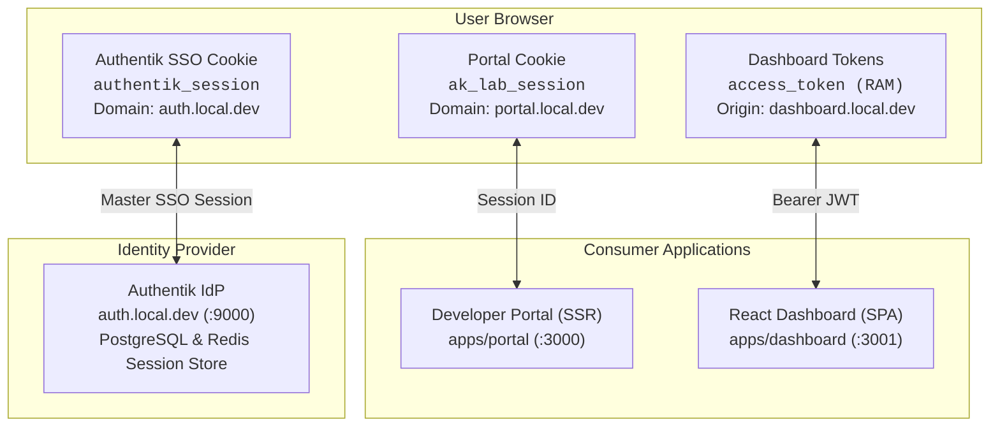
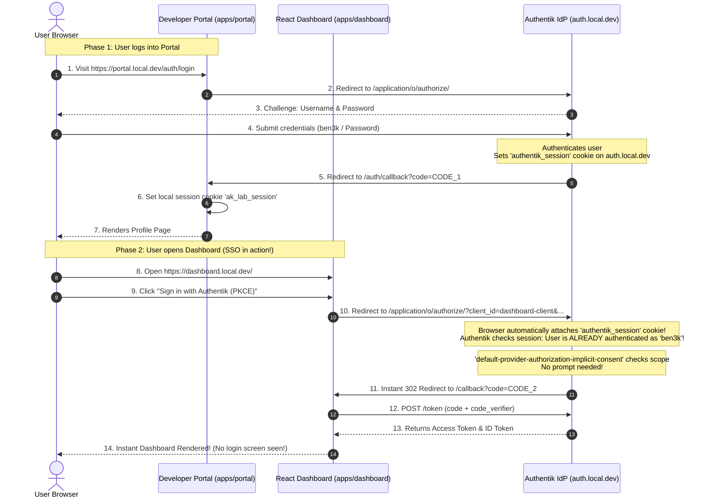
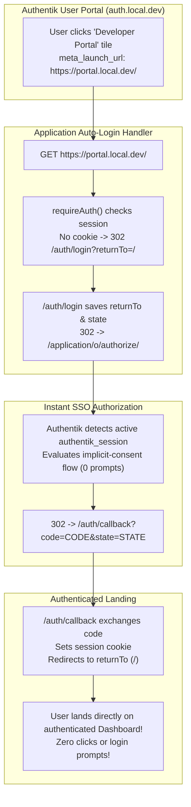
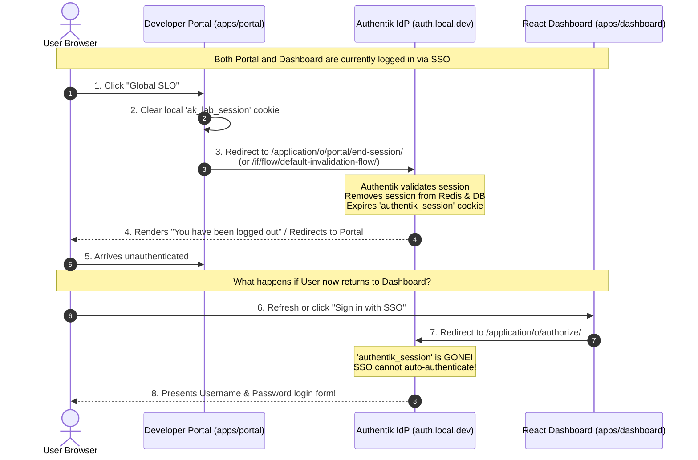

# Chapter 5 — SSO Across Apps: Single Sign-On & Single Logout

In [**Chapter 3**](file:///Users/ben3k/workspace.ben3k/_learn_/authentik_lab_flash/Chapters/Chapter%203.md), we built **`apps/portal`** (a server-rendered Hono app using the Authorization Code flow).
In [**Chapter 4**](file:///Users/ben3k/workspace.ben3k/_learn_/authentik_lab_flash/Chapters/Chapter%204.md), we built **`apps/dashboard`** (a client-side React SPA using the Authorization Code flow with PKCE).

Now we connect the two applications together into a **unified Single Sign-On (SSO) ecosystem**.

By the end of this chapter, you will understand:
1. **How Single Sign-On works across different domains and client architectures**.
2. **The 3-tier session hierarchy**: The central Identity Provider session vs. independent application sessions.
3. Why `dashboard.local.dev` can log you in instantaneously after logging into `portal.local.dev` with **zero credential prompts**.
4. How **Single Logout (SLO)** coordinates session invalidation across multiple federated apps.
5. How to build and share common components across Bun workspace applications using **`packages/ui`**.

---

## 5.1 — Theory: How SSO Works (The IdP Central Session Cookie)

### The Isolation Problem: Browser Cookie Boundaries

In modern web security, the **Same-Origin Policy (SOP)** strictly isolates browser storage:
- `https://portal.local.dev/` can only read its own cookies (`ak_lab_session`).
- `https://dashboard.local.dev/` can only access its own memory or storage.
- Neither application can peek into the other's storage, nor can they access cookies set on `https://auth.local.dev/`.

If applications are completely isolated, how does logging into the **Portal** automatically authenticate the user in the **Dashboard**?

---

### The Three-Tier Session Model

The secret to Single Sign-On is that authentication state does **not** live inside the applications — it lives centrally at the **Identity Provider (Authentik)**:



There are three distinct layers of sessions:

| Session Layer | Stored At | Lifetime | Description |
|---|---|---|---|
| **1. Central IdP Session** | `auth.local.dev` (`authentik_session` cookie) | Long (hours / days) | Represents the master authentication with Authentik in PostgreSQL/Redis. |
| **2. Portal Local Session** | `portal.local.dev` (`ak_lab_session` cookie) | Independent | Signed HTTP-only cookie containing server-side tokens for the SSR app. |
| **3. Dashboard Token Session** | `dashboard.local.dev` (React RAM) | Access Token TTL | In-memory JWT access token used by the SPA to call its backend REST API. |

---

### How Single Sign-On Executes

When a user visits `https://dashboard.local.dev/` after having already authenticated at `https://portal.local.dev/`:



### Why There Is No Login Screen on App #2

1. **Cookie Attachment**: When the browser is redirected from `dashboard.local.dev` to `auth.local.dev/application/o/authorize/`, the browser automatically includes all cookies belonging to `auth.local.dev` — specifically the **`authentik_session`** cookie established during Phase 1.
2. **Session Recognition**: Authentik validates the session ID in Redis/PostgreSQL. It identifies the user as **`ben3k`**.
3. **Implicit Consent**: Because our OAuth2 Provider uses `default-provider-authorization-implicit-consent`, and the requested scopes (`openid profile email`) are already granted, Authentik issues a new Authorization Code **immediately**.
4. **Seamless Return**: The user is bounced right back to `dashboard.local.dev/callback` in milliseconds. To the user, the login feels completely instantaneous!

---

## 5.2 — Verification: Log in to Portal → Visit Dashboard

Let's verify this live across our two running applications:

1. **Open your browser in an Incognito / Private window** (to ensure a fresh state).
2. Visit **`https://portal.local.dev/`**.
3. Click **Sign in with Authentik SSO**.
4. You are presented with Authentik's login form. Enter:
   - **Username**: `ben3k`
   - **Password**: `Password123!` (or your configured password)
5. You land on the **Portal Profile** page (`https://portal.local.dev/profile`).
6. Now, **in the same private window**, open a new tab and navigate to:
   - **`https://dashboard.local.dev/`**
7. Click **Sign in with Authentik (PKCE)**.
8. **Notice what happens**: You are **NOT** prompted for a password! The screen instantly refreshes and renders your authenticated React dashboard with your claims and group badges.

---

### Real-World Deep Dive: The 4KB Cookie Limit & The "Too Many Redirects / CSRF" Loop

During live testing, you may encounter an infamous authentication bug:
> *"After filling credentials, it seems too many redirects, then at the end it says: Invalid state parameter (CSRF detected)."*

Understanding why this occurs reveals a fundamental architectural constraint of web browsers and OIDC tokens:

```mermaid
flowchart TD
    subgraph Step1["1. Callback Handler"]
        T1["OIDC Code Exchanged"] --> T2["Raw Access Token (~1.8KB)<br/>+ ID Token (~1.5KB)<br/>+ Claims JSON (~0.5KB)<br/>= 4,664 Bytes"]
    end

    subgraph Step2["2. Cookie Limit Exceeded"]
        T2 --> T3["Set-Cookie: ak_lab_session (Signed: ~4,750 Bytes)"]
        T3 -->|Exceeds RFC 6265 4,096 byte hard limit| T4["Browser silently drops the session cookie!"]
    end

    subgraph Step3["3. The Infinite Redirect Loop"]
        T4 --> R1["Server redirects to /profile"]
        R1 --> R2["Browser requests /profile without cookie"]
        R2 -->|requireAuth() sees no user| R3["Server redirects to /auth/login"]
        R3 -->|New state generated| R4["Redirects to Authentik IdP"]
        R4 -->|IdP already has SSO session!| R5["Authentik instantly 302s back to /auth/callback"]
        R5 -->|Rapid loop causes race condition or replay| R6["Halts with: Invalid state parameter (CSRF detected)"]
    end
```

#### Why did this happen?
1. **RFC 6265 Hard Limit**: Web browsers strictly enforce a maximum limit of **4,096 bytes** for any single cookie header (including name, value, attributes, and cryptographic signature).
2. **OIDC Token Size**: Enterprise OIDC tokens from providers like Authentik are rich cryptographic documents. An RSA-signed Access Token is ~1.8KB, an ID token is ~1.5KB, plus user claims and refresh tokens. Serializing them into a single cookie generates a payload of **~4.7KB**!
3. **Silent Browser Rejection**: Chrome, Safari, and Firefox do not throw a visible error; they simply reject and drop the oversized `Set-Cookie` header.
4. **The Resulting Loop**: When `/profile` is accessed, the browser sends no cookie. The app redirects to `/auth/login`, which redirects to Authentik. Because Authentik already holds a valid SSO session, it immediately returns an authorization code back to `/auth/callback`. In the span of milliseconds, multiple round-trips take place until the browser stops due to redirect limits or the state parameter cookie becomes desynchronized, producing the CSRF error.

#### The Fix: The Server-Side Session Store Pattern
Never store raw OIDC tokens directly inside stateless browser cookies. Instead:
- Store the full session (`userClaims`, `accessToken`, `idToken`, `refreshToken`) on the **server-side** (e.g., using Bun's native embedded SQLite or Redis).
- Issue only an opaque, cryptographically signed **Session ID** cookie to the browser (`ak_lab_session=<uuid>`, ~150 bytes total).
- On each request, resolve the session ID from the server-side store in microseconds.

Our [`packages/auth/src/session.ts`](file:///Users/ben3k/workspace.ben3k/_learn_/authentik_lab_flash/packages/auth/src/session.ts) implements this pattern via `SqliteSessionStore` and `MemorySessionStore`, shrinking the cookie header from **4,750 bytes** down to **158 bytes**!

---

### 5.2.1 — Seamless IdP-Initiated SSO: Launching from Authentik's App Portal with Zero Prompts

Authentik provides a centralized user dashboard called **"My applications"** (`https://auth.local.dev/if/user/#/library`), which serves as an enterprise launcher for all connected internal and external services.

When a user clicks an application tile in Authentik:
1. **The User Expectation**: *"I am already authenticated in Authentik. When I launch an app tile, I should go straight in with no button to click to sign in."*
2. **The OIDC Reality**: Standard OpenID Connect is strictly **SP-Initiated** (Service Provider-initiated) because the application must generate a cryptographic `state`, `nonce`, and PKCE code challenge. Pure IdP-initiated SAML flows do not directly exist in standard OIDC.



#### Step-by-Step Authentik Admin UI Guide: Configuring Zero-Click SSO Launch URLs

To enable seamless launch from Authentik's *"My applications"* catalog into our applications:

##### Part 1: Setting Application Launch URLs
1. Open your browser to **`https://auth.local.dev/`** and sign in as **`akadmin`**.
2. Click **Admin interface** in the upper right.
3. In the left navigation sidebar, navigate to **Applications** → **Applications**.
4. Configure **`Developer Portal`**:
   - Locate `Developer Portal` in the list and click the pencil icon (✎) to **Edit**.
   - Set **Launch URL**: `https://portal.local.dev/`
   - Click **Update**.
5. Configure **`Developer Dashboard`**:
   - Locate `Developer Dashboard` and click the pencil icon (✎) to **Edit**.
   - Set **Launch URL**: `https://dashboard.local.dev/`
   - Click **Update**.

##### Part 2: Ensuring Instant Authorization (No Consent Prompts)
To prevent Authentik from stopping the user with an *"Application authorization request"* consent dialog on every SSO launch:
1. Navigate to **Applications** → **Providers** in the left sidebar.
2. Edit **`portal-provider`**:
   - Ensure **Authorization flow** is set to: `default-provider-authorization-implicit-consent`.
   - Click **Update**.
3. Edit **`dashboard-provider`**:
   - Ensure **Authorization flow** is set to: `default-provider-authorization-implicit-consent`.
   - Click **Update**.

---

#### How Client Apps Handle the Auto-Login:

1. **Server-Side Rendered Apps (`apps/portal`)**:
   - Enforce authentication on the root route (`app.get("/", requireAuth())`).
   - Store the original destination via `sessionManager.setReturnTo(c, returnTo)`.
   - On callback, resolve `returnTo` and redirect the user straight to their authenticated dashboard (`/`).
2. **Single Page Applications (`apps/dashboard`)**:
   - On initial React mount, if tokens are absent, automatically invoke `handleLogin()` to generate PKCE challenge and bounce through Authentik.
   - Authentik's active session immediately resolves and returns the authorization code, completing the token exchange and rendering the React dashboard in milliseconds.
3. **Handling Intentional Sign Out (Avoiding Relogin Loops)**:
   - In auto-login applications, clicking **"Sign Out"** must invoke **Global Single Logout (SLO)** (`https://auth.local.dev/if/flow/default-invalidation-flow/`).
   - Terminating the master Authentik session prevents the browser from immediately auto-relogging back in when the user intentionally chose to sign out.

---

## 5.3 — Single Logout (SLO) Across Apps

While Single Sign-On makes entering applications effortless, **Single Logout (SLO)** solves the mirror problem: *When a user leaves, how do we safely terminate their identity everywhere?*

### The Distributed Logout Dilemma

In a traditional monolithic application, logging out is straightforward:
```
User clicks Logout -> Server deletes session row in DB -> Server deletes cookie -> Done.
```

In an SSO ecosystem with federated applications, logging out is a distributed systems problem:
- **`apps/portal`** holds an `ak_lab_session` cookie on `portal.local.dev`.
- **`apps/dashboard`** holds an `access_token` in memory on `dashboard.local.dev`.
- **Authentik** holds an `authentik_session` cookie on `auth.local.dev`.
- Additional third-party apps or microservices may hold their own local sessions.

If a user clicks **"Log out"** on `portal.local.dev`, what happens?

### Local Logout vs. Global Single Logout

There are two fundamentally different types of logout:

| Logout Scope | What Gets Destroyed | What Remains Active | Consequence |
|---|---|---|---|
| **Local Logout (App-Only)** | The application's local session cookie (`ak_lab_session`) | Central IdP session (`authentik_session`), other apps' sessions | If the user clicks "Log in" again in that app, Authentik **immediately logs them back in** without asking for credentials! |
| **Global Single Logout (SLO)** | Central IdP session in PostgreSQL/Redis + `authentik_session` cookie | All app sessions (either proactively via backchannel/frontchannel or on next refresh) | The user must re-enter credentials to access **any** application in the ecosystem. |

> [!NOTE]
> Beginners frequently ask: *"I clicked Logout in my app, but when I click Sign in again, it logs me right back in without asking for my password! Is my logout broken?"*
> **No!** That was a **Local Logout**. Because Authentik's master session cookie (`authentik_session`) on `auth.local.dev` is still valid, the SSO mechanism recognized you and signed you back in instantly. To completely log out, an **RP-Initiated Global Logout** must be performed.

---

### The Three OIDC Logout Mechanisms

The OpenID Foundation defines three specifications for coordinating logout across multiple applications:

```mermaid
flowchart TD
    subgraph RPInitiated["1. RP-Initiated Logout (Browser Redirect)"]
        A1["User clicks Logout"] --> A2["RP clears local cookie"]
        A2 --> A3["Redirects browser to IdP end-session endpoint"]
        A3 --> A4["IdP destroys central session"]
        A4 --> A5["IdP redirects back to post_logout_redirect_uri"]
    end

    subgraph FrontChannel["2. Front-Channel Logout (Browser iframes)"]
        B1["IdP Logout Page"] --> B2["Renders hidden iframes pointing to RP logout URLs"]
        B2 --> B3["Browser sends RP cookies in iframes to clear RP sessions"]
        B3 -.->|Broken by modern browsers| B4["Blocked by 3rd-party cookie restrictions (Safari ITP / Chrome Privacy Sandbox)"]
    end

    subgraph BackChannel["3. Back-Channel Logout (Server-to-Server)"]
        C1["IdP invalidates user session"] --> C2["IdP issues signed 'logout_token' JWT"]
        C2 --> C3["IdP POSTs logout_token directly to RP backend"]
        C3 --> C4["RP backend invalidates session in DB/Redis"]
    end
```



#### 1. RP-Initiated Logout (OpenID Connect RP-Initiated Logout 1.0)
This is the standard flow used by most web applications:
1. The user clicks **Logout** in the application.
2. The application deletes its local cookie / session.
3. The application redirects the browser to Authentik's end-session endpoint:
   ```
   https://auth.local.dev/application/o/<slug>/end-session/?post_logout_redirect_uri=https://portal.local.dev/
   ```
   or Authentik's global invalidation flow:
   ```
   https://auth.local.dev/if/flow/default-invalidation-flow/
   ```
4. Authentik destroys the master `authentik_session` in Redis/PostgreSQL.
5. Authentik redirects the browser back to `post_logout_redirect_uri`.

#### 2. Front-Channel Logout (OpenID Connect Front-Channel Logout 1.0)
When the user logs out at Authentik, Authentik returns an HTML page containing hidden `<iframe>` tags pointing to every registered app's front-channel logout URL. The browser executes those requests with each app's cookies attached.
- **Drawback**: Modern browser privacy protections (such as Safari ITP and Chrome's third-party cookie phaseout) block cookies in cross-origin `<iframe>`s, making Front-Channel logout increasingly unreliable.

#### 3. Back-Channel Logout (OpenID Connect Back-Channel Logout 1.0)
The modern, robust standard. When Authentik terminates a session:
1. Authentik generates a signed JWT called a **`logout_token`** containing the user's `sub` or `sid`.
2. Authentik makes a direct server-to-server `POST` request to each application's backchannel logout endpoint (`https://portal.local.dev/auth/backchannel-logout`).
3. The application backend verifies the JWT and purges the corresponding session from Redis or database.
4. This completely bypasses the browser and does not rely on third-party cookies.

---

### Step-by-Step RP-Initiated Single Logout Sequence



---

## 5.4 — Build a Shared Navigation Bar (`packages/ui`)

To give users a unified experience across all our services, we build a **shared UI package** in our Bun monorepo: [**`packages/ui`**](file:///Users/ben3k/workspace.ben3k/_learn_/authentik_lab_flash/packages/ui).

### Monorepo Architecture: Supporting Both SSR and SPA

Our monorepo contains two different frontend technologies:
1. **`apps/portal`**: Server-Side Rendered (SSR) using **Hono JSX**.
2. **`apps/dashboard`**: Client-Side Single Page Application (SPA) using **React 19**.

Rather than duplicating HTML structures and CSS styles across both apps, we structure `packages/ui` with specialized subpath exports:

```
packages/ui/
├── package.json          # Declares subpath exports (. / .hono / .react)
├── tsconfig.json         # TypeScript configuration
└── src/
    ├── index.ts          # Shared types (NavUser, NavAppItem) & app registry (LAB_APPLICATIONS)
    ├── hono.tsx          # Server component: HonoNavbar (for apps/portal)
    └── react.tsx         # Client component: ReactNavbar (for apps/dashboard)
```

#### 1. Central Application Registry (`packages/ui/src/index.ts`)
```typescript
export interface NavUser {
  name?: string;
  preferred_username?: string;
  email?: string;
  groups?: string[];
  sub?: string;
}

export interface NavAppItem {
  id: "portal" | "dashboard" | "auth";
  label: string;
  href: string;
  badge: string;
  badgeColor: string;
}

export const LAB_APPLICATIONS: NavAppItem[] = [
  {
    id: "portal",
    label: "Developer Portal",
    href: "https://portal.local.dev/",
    badge: "SSR",
    badgeColor: "bg-emerald-500/20 text-emerald-300 border-emerald-500/30",
  },
  {
    id: "dashboard",
    label: "React Dashboard",
    href: "https://dashboard.local.dev/",
    badge: "PKCE",
    badgeColor: "bg-indigo-500/20 text-indigo-300 border-indigo-500/30",
  },
  {
    id: "auth",
    label: "Authentik IdP",
    href: "https://auth.local.dev/",
    badge: "SSO",
    badgeColor: "bg-amber-500/20 text-amber-300 border-amber-500/30",
  },
];
```

#### 2. Package Exports Configuration (`packages/ui/package.json`)
```json
{
  "name": "@authentik-lab/ui",
  "version": "1.0.0",
  "private": true,
  "main": "./src/index.ts",
  "types": "./src/index.ts",
  "exports": {
    ".": "./src/index.ts",
    "./hono": "./src/hono.tsx",
    "./react": "./src/react.tsx"
  },
  "dependencies": {
    "hono": "^4.13.13"
  },
  "peerDependencies": {
    "react": ">=18.0.0",
    "react-dom": ">=18.0.0"
  }
}
```

#### 3. Consuming in the SSR Portal (`apps/portal/src/layout.tsx`)
```tsx
import type { FC, PropsWithChildren } from "hono/jsx";
import type { UserClaims } from "@authentik-lab/auth";
import { HonoNavbar } from "@authentik-lab/ui/hono";

export const Layout: FC<PropsWithChildren<LayoutProps>> = ({ children, user }) => {
  return (
    <html lang="en">
      <body class="bg-slate-950 text-slate-100 min-h-screen flex flex-col">
        {/* Unified SSO Navbar */}
        <HonoNavbar currentApp="portal" user={user} onLogoutHref="/auth/logout" />
        
        {/* Sub-nav & Main Content */}
        <main class="flex-1 max-w-6xl w-full mx-auto px-6 py-10">
          {children}
        </main>
      </body>
    </html>
  );
};
```

#### 4. Consuming in the React Dashboard (`apps/dashboard/src/client/App.tsx`)
```tsx
import React, { useState, useEffect } from "react";
import { ReactNavbar } from "@authentik-lab/ui/react";

export function App() {
  const [tokens, setTokens] = useState<TokenResponse | null>(null);
  const [user, setUser] = useState<UserProfile | null>(null);

  return (
    <div className="min-h-screen bg-slate-950 text-slate-100 flex flex-col">
      {/* Unified SSO Navbar */}
      <ReactNavbar
        currentApp="dashboard"
        user={user}
        onLogin={handleLogin}
        onLogout={handleLogout}
        loading={loading}
      />
      
      {/* Dashboard Body */}
      <main className="max-w-6xl mx-auto px-6 py-10 flex-1 w-full">
        {/* ... */}
      </main>
    </div>
  );
}
```

---

### Hands-on Verification: Seamless Navigation & SLO

1. **Verify the Unified Navigation**:
   - Open **`https://portal.local.dev/`**.
   - Notice the top navigation bar displays the **Authentik Lab** branding with three app switches:
     - **Developer Portal** (badge: `SSR`, highlighted active)
     - **React Dashboard** (badge: `PKCE`)
     - **Authentik IdP** (badge: `SSO`)
2. **One-Click Cross-App Jump**:
   - Click **React Dashboard** in the navbar.
   - You seamlessly land on `https://dashboard.local.dev/`.
   - The same consistent navbar appears, with **React Dashboard** highlighted!
3. **Verify Single Logout (SLO)**:
   - When logged in, click the **SLO (Global)** button in the navbar.
   - You are redirected to Authentik's invalidation flow (`https://auth.local.dev/if/flow/default-invalidation-flow/`).
   - Authentik invalidates your session.
   - Now try logging in again to either **Portal** or **Dashboard**:
   - Notice that you are prompted for your **Username and Password** because the central SSO session has been completely invalidated!

---

## Chapter 5 Summary

| Concept | Explanation |
|---|---|
| **Central IdP Session** | A persistent session maintained by Authentik (`authentik_session` cookie on `auth.local.dev`), independent of consumer applications. |
| **SSO Mechanics** | Consumer apps redirect to Authentik; browser passes `authentik_session`; Authentik issues tokens without re-prompting. |
| **Local Logout** | Invalidates only the local app session (cookie or RAM tokens). IdP session remains intact. |
| **Single Logout (SLO)** | RP-Initiated, Front-Channel, or Back-Channel invalidation of the master IdP session and federated clients. |
| **`packages/ui`** | Reusable cross-framework component package sharing navigation, app metadata, and user controls across Hono JSX and React. |
