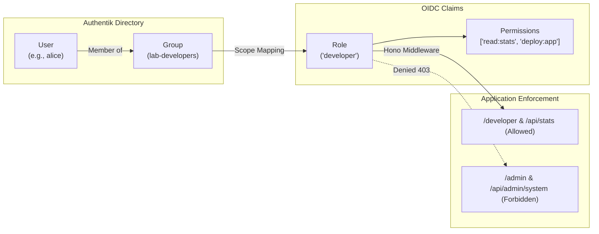
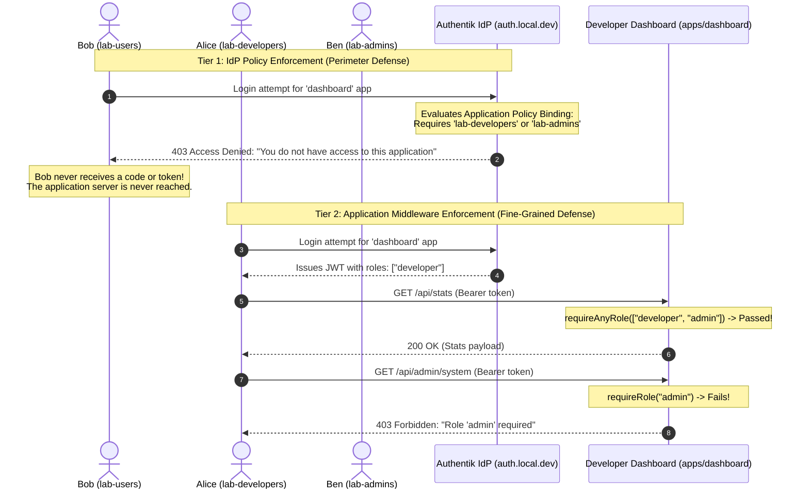

# Chapter 6 — RBAC: Roles & Permissions (Groups, Scopes, and Policy Enforcement)

In [**Chapter 3**](file:///Users/ben3k/workspace.ben3k/_learn_/authentik_lab_flash/Chapters/Chapter%203.md), we implemented server-side authentication for `apps/portal` via the Authorization Code Flow.  
In [**Chapter 4**](file:///Users/ben3k/workspace.ben3k/_learn_/authentik_lab_flash/Chapters/Chapter%204.md), we built a React SPA (`apps/dashboard`) using the PKCE flow with remote JWKS verification.  
In [**Chapter 5**](file:///Users/ben3k/workspace.ben3k/_learn_/authentik_lab_flash/Chapters/Chapter%205.md), we connected them with centralized Single Sign-On (SSO) and Single Logout (SLO).

Now that users can sign into any application, we face the next critical security requirement:  
**Not all authenticated users should have the same level of access.**

By the end of this chapter, you will understand:
1. **The difference between Authentication (AuthN) and Authorization (AuthZ)**.
2. **The Role-Based Access Control (RBAC) model** and how OIDC handles roles.
3. How to manage **Groups and User memberships in Authentik**.
4. How to use **Authentik Scope Mappings (Python expressions)** to inject custom `roles` and `permissions` claims into tokens.
5. How to build **reusable RBAC middleware** in `@authentik-lab/auth` for both SSR cookie sessions and JWT Bearer REST APIs.
6. How to implement **conditional UI rendering** without compromising security.
7. How to configure **Authentik Application Policies** to block unauthorized users at the IdP perimeter *before* tokens are ever minted.

---

## 6.1 — Theory: Groups, Roles & Claims in OIDC

### 1. Authentication vs. Authorization

When securing distributed architectures, never confuse these two concepts:

| Dimension | Authentication (AuthN) | Authorization (AuthZ) |
|---|---|---|
| **Question** | *"Who are you?"* | *"What are you permitted to do?"* |
| **Output** | Verified User Identity (`sub`, `email`, `name`) | Roles, permissions, access decisions (`admin`, `read:stats`, `deploy`) |
| **Protocol** | OpenID Connect (ID Token) | OAuth2 Scopes / RBAC Claims / IdP Policies |
| **Example** | *"This user is Alice (alice@local.dev)."* | *"Alice is a Developer; she can call `/api/stats`, but cannot access `/admin`."* |

---

### 2. The RBAC Mental Model

In **Role-Based Access Control (RBAC)**, permissions are not granted directly to individual users. Instead, they flow through an abstraction layer:



1. **User**: The individual human account (e.g. `ben3k`, `alice`, `bob`).
2. **Group**: The organizational unit in Authentik (e.g. `lab-admins`, `lab-developers`, `lab-users`).
3. **Role**: The application-level role mapped from groups (e.g. `admin`, `developer`, `viewer`).
4. **Permissions**: The discrete actions a role can perform (e.g. `read:stats`, `manage:users`).

---

### 3. The Two Defense Tiers: Perimeter vs. Application

In a robust architecture, authorization occurs at **two distinct levels**:



1. **Tier 1 — IdP Policy Enforcement (Perimeter Defense)**:
   - Configured in Authentik on the **Application** itself.
   - Blocks users from entering an application if they lack group membership.
   - **Advantage**: The client application never executes code for an unauthorized user; zero tokens are minted.
2. **Tier 2 — Application Middleware Enforcement (Fine-Grained Defense)**:
   - Executed inside the application code (Hono middleware).
   - Allows users inside the application, but restricts specific routes, HTTP verbs, or actions (e.g., viewing public reports vs. deleting records).

---

## 6.2 — Create Groups in Authentik (admin, developer, user)

To test RBAC across our applications, we define three standard personas:

| User | Password | Authentik Groups | Mapped Role | Allowed Access |
|---|---|---|---|---|
| **`ben3k`** | `Password123!` | `lab-admins`, `lab-developers` | `admin` | Portal, Dev Console, Admin Console, all APIs |
| **`alice`** | `Password123!` | `lab-developers` | `developer` | Portal, Dev Console, `/api/stats` (Blocked from Admin) |
| **`bob`** | `Password123!` | `lab-users` | `viewer` | Portal (Home & Profile only, blocked from Dashboard & Admin) |

---

### Step-by-Step Authentik Admin UI Guide: Managing Groups & Users

#### Part 1: Creating Organizational Groups
1. Open your browser to **`https://auth.local.dev/`** and sign in as **`akadmin`**.
2. In the top-right header, click **Admin interface** (if not already in the admin console).
3. Expand the left navigation sidebar: **Directory** → **Groups**.
4. Click the blue **Create** button in the upper-right corner.
5. Create each of the three groups using the following parameters:

| Field | Group 1 | Group 2 | Group 3 | Purpose |
|---|---|---|---|---|
| **Name** | `lab-admins` | `lab-developers` | `lab-users` | Unique group identifier in Authentik DB |
| **Is Superuser?** | Unchecked | Unchecked | Unchecked | Only check for Authentik server superadmins |
| **Parent** | *(None)* | *(None)* | *(None)* | Flat hierarchy |

6. Click **Create** to save each group. You will see all three groups listed in the Groups table.

---

#### Part 2: Assigning Users to Groups
1. Navigate to **Directory** → **Users** in the left sidebar.
2. Configure **`ben3k`**:
   - Click on the username **`ben3k`** (or click the three-dots ⋮ icon → **Edit**).
   - In the user detail screen, switch to the **Groups** tab.
   - Click **Add to group**.
   - Select **`lab-admins`** and click **Add**.
   - Click **Add to group** again, select **`lab-developers`**, and click **Add**.
3. Configure **`alice`**:
   - Return to **Directory** → **Users** and click **`alice`**.
   - Switch to the **Groups** tab → Click **Add to group** → Select **`lab-developers`** → Click **Add**.
4. Configure **`bob`**:
   - Return to **Directory** → **Users** and click **`bob`**.
   - Switch to the **Groups** tab → Click **Add to group** → Select **`lab-users`** → Click **Add**.

> [!TIP]
> **Automated Verification**: If you ever reset your Docker database, you can run `docker exec -i authentik-server ak shell < scripts/seed-authentik.py` to recreate these users and group bindings automatically.

---

## 6.3 — Map Groups to OIDC Claims (Custom Scopes & Property Mappings)

### The Limitation of Standard OIDC Scopes

The standard OpenID Connect specification only defines identity scopes:
- `openid`: Returns `sub` (subject identifier).
- `profile`: Returns `name`, `preferred_username`, `picture`, etc.
- `email`: Returns `email` and `email_verified`.

There is no standard `roles` scope in the base OIDC specification. Different identity providers handle roles differently:
- Keycloak uses `resource_access` or `realm_access`.
- Auth0 uses custom namespace claims (e.g. `https://my-app.com/roles`).
- **Authentik uses Python-powered Property Mappings!**

---

### Step-by-Step Authentik Admin UI Guide: Creating the Custom Scope Mapping

In Authentik, a **Scope Mapping** is a Python expression that executes whenever an OAuth2 / OIDC client requests a specific scope name. It allows you to transform raw group memberships into clean, decoupled application roles and permissions.

#### Part 1: Create the Property Mapping
1. In the Authentik Admin interface, expand the left sidebar: **Customization** → **Property Mappings**.
2. Click the blue **Create** button in the upper-right corner.
3. In the modal dialog, Authentik asks: *"Select Property Mapping type"*.
   - Select **Scope Mapping** (used for OpenID Connect / OAuth2).
   - Click **Next**.
4. Fill out the Scope Mapping form with the exact settings below:

| Field | Value | Purpose |
|---|---|---|
| **Name** | `authentik lab: Roles and Permissions` | Descriptive label in Authentik's mapping catalog |
| **Scope name** | `roles` | The exact OAuth2 scope that triggers this mapping (e.g. `scope="openid profile email roles"`) |
| **Description** | `Maps Authentik groups (lab-admins, lab-developers, lab-users) to app roles and permissions.` | Admin documentation note |
| **Expression** | *(Paste the Python code below)* | The Python function executed by Authentik's Celery/Worker |

```python
# Authentik Scope Mapping Expression
# Context variables available: request.user, provider, request.http_request
groups = [g.name for g in request.user.ak_groups.all()]
roles = []

# 1. Map organizational groups to application roles
if "lab-admins" in groups:
    roles.append("admin")
if "lab-developers" in groups:
    roles.append("developer")
if "lab-users" in groups:
    roles.append("viewer")

# 2. Return dictionary of custom claims injected into tokens
return {
    "roles": roles,
    "is_admin": "lab-admins" in groups,
    "permissions": ["read:profile"] + (
        ["read:stats", "deploy:app"] if ("developer" in roles or "admin" in roles) else []
    ) + (
        ["manage:users", "system:admin"] if "admin" in roles else []
    ),
}
```

5. Click **Create** to save the mapping.

---

#### Part 2: Test the Mapping Live Using Authentik's Built-In Evaluator

Before launching our applications, Authentik lets you test Property Mappings live against real users directly inside the Admin UI!

1. Still on the **Customization** → **Property Mappings** page, locate **`authentik lab: Roles and Permissions`** in the table.
2. On the right side of the row, click the three-dots (⋮) menu button → Click **Test**.
3. In the **Test Property Mapping** modal dialog:
   - In the **User** dropdown, search for and select **`ben3k`**.
   - Click **Test**.
   - In the **Result** preview box, verify the output:
     ```json
     {
       "roles": ["admin", "developer"],
       "is_admin": true,
       "permissions": ["read:profile", "read:stats", "deploy:app", "manage:users", "system:admin"]
     }
     ```
4. Repeat the test for **`alice`**:
   - Change User to **`alice`** → Click **Test**.
   - Verify: `"roles": ["developer"]`, `"is_admin": false`, `"permissions": ["read:profile", "read:stats", "deploy:app"]`.
5. Repeat the test for **`bob`**:
   - Change User to **`bob`** → Click **Test**.
   - Verify: `"roles": ["viewer"]`, `"is_admin": false`, `"permissions": ["read:profile"]`.
6. Click **Close**. You have confirmed that the Python mapping works with 100% precision!

---

#### Part 3: Attach the Scope Mapping to OAuth2 Providers

Now that the mapping exists, we must bind it to the providers so Authentik evaluates it during token minting.

1. In the left sidebar, navigate to **Applications** → **Providers**.
2. **Update `portal-provider`**:
   - Locate `portal-provider` and click the pencil icon (✎) to **Edit**.
   - Scroll down to the **Advanced protocol settings** section (click to expand).
   - In the **Selected property mappings** (or Scope mappings) list, locate **`authentik lab: Roles and Permissions`** and check its box (ensure `authentik default OAuth Mapping: OpenID 'openid'`, `'email'`, and `'profile'` remain checked as well).
   - Click **Update**.
3. **Update `dashboard-provider`**:
   - Locate `dashboard-provider` and click the pencil icon (✎) to **Edit**.
   - Expand **Advanced protocol settings**.
   - Check **`authentik lab: Roles and Permissions`**.
   - Click **Update**.

Now, whenever `apps/portal` or `apps/dashboard` requests `scope=openid profile email roles`, Authentik automatically injects `roles`, `permissions`, and `is_admin` into the ID Token, Access Token, and `/userinfo` endpoint!

---

## 6.4 — Enforce Roles in Hono Middleware

In [**`packages/auth/src/middleware.ts`**](file:///Users/ben3k/workspace.ben3k/_learn_/authentik_lab_flash/packages/auth/src/middleware.ts), we build unified RBAC middleware guards that work seamlessly with both:
1. **Cookie-based SSR Sessions** (`apps/portal`).
2. **Bearer JWTs** (`apps/dashboard`).

```typescript
import type { Context, MiddlewareHandler } from "hono";
import type { UserClaims } from "./types";

/**
 * Extracts claims from either the SSR cookie session or the verified JWT payload.
 */
export function getEffectiveUser(c: Context): UserClaims | null {
  return c.get("user") || c.get("jwtUser") || null;
}

/**
 * Route guard that requires at least one of the specified roles (OR logic).
 */
export function requireAnyRole(roles: string[]): MiddlewareHandler {
  return async (c: Context, next) => {
    const user = getEffectiveUser(c);
    if (!user) {
      if (c.req.path.startsWith("/api/")) {
        return c.json({ error: "Unauthorized", message: "Authentication required" }, 401);
      }
      return c.redirect("/auth/login");
    }

    const userRoles = (user.roles as string[]) || [];
    const hasRole = roles.some((r) => userRoles.includes(r));

    if (!hasRole) {
      if (c.req.path.startsWith("/api/")) {
        return c.json(
          {
            error: "Forbidden",
            message: `Access denied. Requires one of roles: [${roles.join(", ")}]`,
            userRoles,
          },
          403
        );
      }
      return renderForbiddenHtml(c, user, `Role: ${roles.join(" or ")}`, userRoles);
    }

    await next();
  };
}

/**
 * Route guard that requires a single specific role.
 */
export function requireRole(role: string): MiddlewareHandler {
  return requireAnyRole([role]);
}
```

---

### Protecting SSR Routes in `apps/portal`

In [**`apps/portal/src/index.tsx`**](file:///Users/ben3k/workspace.ben3k/_learn_/authentik_lab_flash/apps/portal/src/index.tsx):

```tsx
// 1. Developer Console: accessible to 'developer' OR 'admin'
app.get("/developer", requireAnyRole(["developer", "admin"]), (c) => {
  const user = c.get("user")!;
  return c.html(<Layout user={user}>...</Layout>);
});

// 2. Admin Console: strictly restricted to 'admin' role
app.get("/admin", requireRole("admin"), (c) => {
  const user = c.get("user")!;
  return c.html(<Layout user={user}>...</Layout>);
});
```

---

### Protecting REST APIs in `apps/dashboard`

In [**`apps/dashboard/src/index.ts`**](file:///Users/ben3k/workspace.ben3k/_learn_/authentik_lab_flash/apps/dashboard/src/index.ts):

```typescript
// 1. /api/stats: Validates Bearer JWT AND requires 'developer' or 'admin'
app.get("/api/stats", requireJwtAuth(), requireAnyRole(["developer", "admin"]), (c) => {
  const user = c.get("jwtUser");
  return c.json({ status: "ok", metrics: { uptime: "99.99%", clusters: 4 } });
});

// 2. /api/admin/system: Validates Bearer JWT AND strictly requires 'admin'
app.get("/api/admin/system", requireJwtAuth(), requireRole("admin"), (c) => {
  const user = c.get("jwtUser");
  return c.json({ status: "ok", system: { activeSsoSessions: 14 } });
});
```

---

## 6.5 — Conditional UI Rendering Based on Roles

> [!IMPORTANT]
> **The Golden Rule of UI Security**:  
> *Hiding a button or navigation link in HTML/React is purely for User Experience (UX), never for Security.*  
> A malicious user can always inspect client code, craft a direct `fetch()` call, or type a URL manually. Real security is **always enforced on the server** by middleware.

### 1. Conditional Rendering in Server-Side JSX (`apps/portal`)

In [**`apps/portal/src/layout.tsx`**](file:///Users/ben3k/workspace.ben3k/_learn_/authentik_lab_flash/apps/portal/src/layout.tsx):

```tsx
<div class="flex items-center gap-4 text-xs font-medium text-slate-400">
  <a href="/profile">Profile</a>
  <a href="/developer">Dev Console</a>

  {user?.roles?.includes("admin") || user?.groups?.includes("lab-admins") ? (
    <a href="/admin" class="text-amber-400 font-semibold flex items-center gap-1.5">
      <span>Admin Console</span>
      <span class="text-[9px] px-1.5 py-0.5 rounded bg-amber-500/20 text-amber-300 font-mono">Admin</span>
    </a>
  ) : (
    <a href="/admin" class="text-slate-500 hover:text-slate-400 flex items-center gap-1">
      <span>Admin (Protected)</span>
      <span class="text-[10px]">🔒</span>
    </a>
  )}
</div>
```

### 2. Conditional Rendering in Client-Side React (`apps/dashboard`)

In [**`apps/dashboard/src/client/App.tsx`**](file:///Users/ben3k/workspace.ben3k/_learn_/authentik_lab_flash/apps/dashboard/src/client/App.tsx):

```tsx
{/* Conditionally rendered only if user possesses the 'admin' role */}
{(user.roles?.includes("admin") || user.groups?.includes("lab-admins")) && (
  <div className="p-6 rounded-2xl border border-amber-500/30 bg-amber-500/5 space-y-4">
    <div className="flex items-center justify-between">
      <div>
        <span className="text-amber-400 font-bold">🛡️ Admin Operations Console</span>
        <p className="text-xs text-slate-400">Calls protected /api/admin/system</p>
      </div>
      <button
        onClick={callAdminApi}
        className="px-4 py-2 rounded-xl bg-amber-600 hover:bg-amber-500 text-white text-xs font-semibold"
      >
        Call /api/admin/system
      </button>
    </div>
  </div>
)}
```

---

## 6.6 — Authentik Policies: Restrict App Access by Group (Perimeter Defense)

While application middleware stops users inside an app, Authentik's **Policy Engine** allows you to block users at the **Identity Provider perimeter**.

### How Application Policy Bindings Work

Every Authentik `Application` inherits from `PolicyBindingModel`. When a client initiates the `/application/o/authorize/` flow, Authentik checks whether the authenticating user matches the policies bound to that application.

If an application is restricted to `lab-developers` and `lab-admins`:
1. When **Alice** logs in: She is in `lab-developers` → Authentik permits the flow → Authorization code is issued.
2. When **Bob** logs in: He is only in `lab-users` → Authentik halts the login flow immediately and renders an **Access Denied** error page.
3. **Bob never receives an authorization code, and `apps/dashboard` never receives a request.**

---

### Step-by-Step Authentik Admin UI Guide: Configuring Perimeter Access Policies

Authentik gives you two ways to enforce perimeter access on applications: **Direct Group Binding** (fastest and simplest) and **Group Membership Policies** (for complex multi-rule logic).

#### Method A: Direct Group Binding (Recommended for Simple RBAC)

1. Open the Authentik Admin interface (**`https://auth.local.dev/`**).
2. In the left sidebar, navigate to **Applications** → **Applications**.
3. In the applications list, click on **`Developer Dashboard`** (or its slug `dashboard`).
4. In the application detail view, click the **Policy / Group / User Bindings** tab.
5. Click the **Bind Group** button (or click **Bind Existing Policy/Group** → select **Group**).
6. Fill in the binding modal for Developers:

| Field | Value | Purpose |
|---|---|---|
| **Group** | `lab-developers` | Grants all members of this group access |
| **Order** | `0` | Execution priority |
| **Negate** | Unchecked | If checked, it would deny members of this group |
| **Enabled** | Checked | Activates the rule |

7. Click **Create**.
8. Repeat for Administrators:
   - Click **Bind Group**.
   - Select Group: **`lab-admins`**.
   - Order: **`1`**.
   - Click **Create**.

> [!NOTE]
> Authentik evaluates multiple group bindings using **OR logic** by default. Any user who is a member of *either* `lab-developers` *or* `lab-admins` will be granted access to launch the application.

---

#### Method B: Reusable Group Membership Policy (Policy Engine)

If you have complex logic (e.g., must be in Group A **AND** Group B, or must have MFA enrolled), use Authentik's formal Policy Engine:

1. Expand the left sidebar: **Customization** → **Policies**.
2. Click **Create** → In the dropdown, choose **Group Membership Policy** → Click **Next**.
3. Fill in the policy settings:
   - **Name**: `policy-allow-developers`
   - **Group**: `lab-developers`
4. Click **Create**.
5. Return to **Applications** → **Applications** → Click **`Developer Dashboard`** → **Policy / Group / User Bindings** tab.
6. Click **Bind Policy** → Select **`policy-allow-developers`** → Order: `0` → Click **Create**.

---

### Hands-on Verification: Testing All Three Personas

Now that both **Tier 1 (Perimeter Policy)** and **Tier 2 (Application Middleware)** are configured, let's test all three personas across our applications:

#### Test 1: Ben (Admin)
1. In an Incognito window, visit **`https://portal.local.dev/`**.
2. Sign in as **`ben3k`** / `Password123!`.
3. Check the authenticated dashboard:
   - You land directly inside Portal (`/`) without prompts.
   - Click **View User Profile & Claims** (`/profile`): Claims include `roles: ["admin", "developer"]` and `is_admin: true`.
4. Click **Developer Console** (`/developer`) → **200 OK (Access Granted)**.
5. Click **Admin Console** (`/admin`) → **200 OK (Access Granted)**.
6. Open **`https://dashboard.local.dev/`** (in the same browser session):
   - Instant SSO login completes.
   - The **Admin Operations Console** card is visible.
   - Click **Call /api/admin/system** → Returns **200 OK** with live system metrics!

---

#### Test 2: Alice (Developer)
1. Click **Sign Out** (this triggers Authentik's Global SLO).
2. Visit **`https://portal.local.dev/`** and sign in as **`alice`** / `Password123!`.
3. Visit **`https://portal.local.dev/profile`**:
   - Claims include: `roles: ["developer"]`.
4. Visit **`https://portal.local.dev/developer`** → **200 OK (Access Granted)**.
5. Try to visit **`https://portal.local.dev/admin`**:
   - **403 Forbidden!** Intercepted by `requireRole("admin")`.
   - The styled page displays: `Your account alice lacks required permission: Role: admin`.
6. Open **`https://dashboard.local.dev/`**:
   - Alice is a member of `lab-developers`, so Authentik's perimeter policy allows her into the Dashboard.
   - Notice the **Admin Operations Console** is conditionally hidden.
   - Calling `/api/stats` succeeds with `200 OK`; attempting to call `/api/admin/system` directly returns `403 Forbidden`.

---

#### Test 3: Bob (Regular User)
1. Sign out and sign in as **`bob`** / `Password123!`.
2. Visit **`https://portal.local.dev/profile`**:
   - Claims include: `roles: ["viewer"]`.
3. Try to visit **`https://portal.local.dev/developer`** → **403 Forbidden!**
4. Try to visit **`https://portal.local.dev/admin`** → **403 Forbidden!**
5. Now test **Tier 1 Perimeter Defense**:
   - Navigate to **`https://dashboard.local.dev/`** (or click its tile from Authentik's *"My applications"* page).
   - **Authentik halts Bob before entering!**
   - Because Bob is only in `lab-users` (not `lab-developers` or `lab-admins`), Authentik displays:  
     **"Access Denied: You do not have access to this application."**
   - Bob never receives an authorization code or token, and `apps/dashboard` is completely protected!

---

## Chapter 6 Summary

| Level | Mechanism | Where Enforced | Best For |
|---|---|---|---|
| **Perimeter** | Authentik Policy Binding | Authentik IdP (`auth.local.dev`) | Restricting entire application access before token issuance. |
| **Token Mapping** | Authentik Scope Mapping | Authentik IdP at token generation | Translating enterprise groups into normalized application roles and permissions. |
| **Application** | Hono RBAC Middleware | Application backend (`@authentik-lab/auth`) | Restricting specific pages (`/admin`) or API endpoints (`/api/admin/system`). |
| **Presentation** | Conditional Rendering | React / Hono JSX | Improving user experience by hiding controls that users lack permission to use. |
