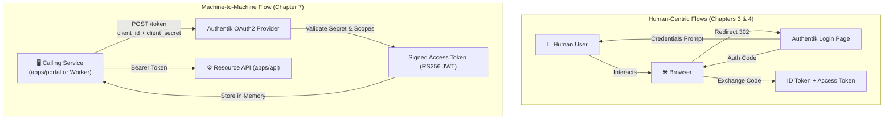
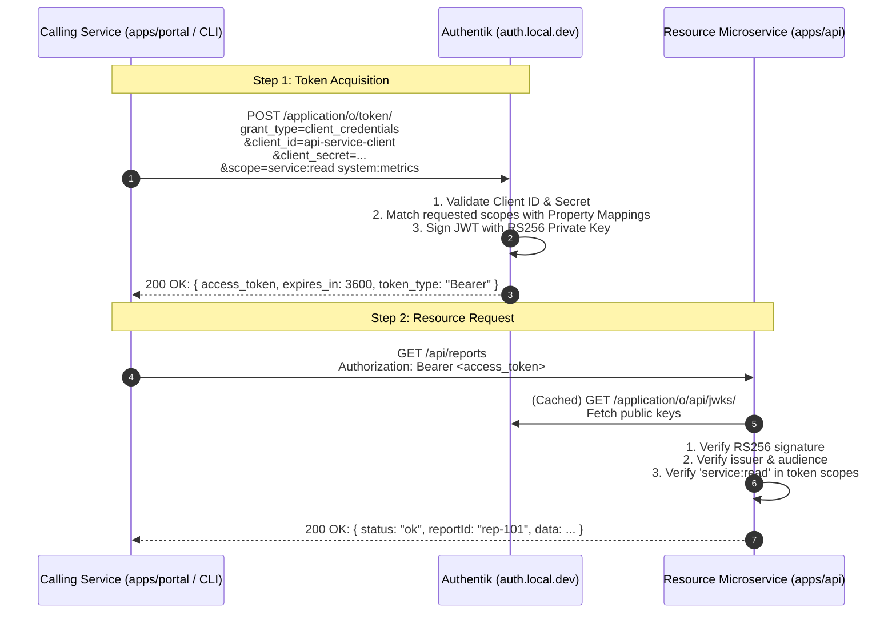

# Chapter 7 — API-to-API: Client Credentials Flow (Machine-to-Machine Auth & Scope Enforcement)

In [**Chapter 3**](file:///Users/ben3k/workspace.ben3k/_learn_/authentik_lab_flash/Chapters/Chapter%203.md), we built server-side authentication for `apps/portal` using the Authorization Code Flow.  
In [**Chapter 4**](file:///Users/ben3k/workspace.ben3k/_learn_/authentik_lab_flash/Chapters/Chapter%204.md), we built a client-side Single Page App (`apps/dashboard`) using the PKCE flow.  
In [**Chapter 5**](file:///Users/ben3k/workspace.ben3k/_learn_/authentik_lab_flash/Chapters/Chapter%205.md), we unified them with Centralized SSO and Single Logout.  
In [**Chapter 6**](file:///Users/ben3k/workspace.ben3k/_learn_/authentik_lab_flash/Chapters/Chapter%206.md), we implemented Role-Based Access Control (RBAC) via Authentik Property Mappings and Application Policies.

In all those chapters, **a human user was sitting in front of a web browser**, typing a username and password, approving consent prompts, and maintaining an interactive session cookie.

Now, consider a different and extremely common production scenario:
- A background worker needs to poll an internal billing microservice.
- A batch data pipeline needs to ingest telemetry records into an analytics API.
- Your frontend backend (e.g. `apps/portal`) needs to call a secure downstream resource microservice (`apps/api`) to fetch cluster metrics on behalf of the system, not tied to any individual user's session.

There is **no browser**, **no interactive login form**, and **no human user**. How do two backend services authenticate and authorize with each other securely without hardcoding shared database passwords?

The answer is the **OAuth2 Client Credentials Grant** ([RFC 6749 §4.4](https://datatracker.ietf.org/doc/html/rfc6749#section-4.4)).

---

## What You Will Learn in This Chapter

1. **Machine-to-Machine (M2M) Architecture**: Why user-centric flows fail for backend microservices and how Client Credentials solves service identity.
2. **The Client Credentials Grant Lifecycle**: Direct server-to-server token exchange with no browser redirects.
3. **Tokens vs. Sessions**: Why M2M uses short-lived stateless JWTs without Refresh Tokens or session cookies.
4. **Authentik Admin UI Configuration**: Step-by-step guide to creating a Confidential Machine Provider, configuring M2M Scope Mappings, and registering an API Application.
5. **Reusable Client Library**: Implementing [`ClientCredentialsClient`](file:///Users/ben3k/workspace.ben3k/_learn_/authentik_lab_flash/packages/auth/src/client-credentials.ts) in `@authentik-lab/auth` with in-memory token caching and preemptive refresh.
6. **Stateless Remote JWKS Verification**: Implementing [`requireM2MAuth`](file:///Users/ben3k/workspace.ben3k/_learn_/authentik_lab_flash/apps/api/src/index.ts#L39-L98) middleware in Hono to validate RS256 signatures, audience, issuer, and fine-grained OAuth2 scopes (`service:read`, `service:write`, `system:metrics`).
7. **Cross-Service Verification**: Calling the protected API from CLI scripts, curl, and within our SSR Portal application.

---

## 7.1 — Theory: Machine-to-Machine Auth (No User Involved)

### 1. User Flows vs. Machine-to-Machine Flows

Let's contrast the flows we have learned so far with the Client Credentials flow:

| Dimension | Authorization Code (Chapter 3) | PKCE Flow (Chapter 4) | Client Credentials (Chapter 7) |
|---|---|---|---|
| **Actor** | Human User + Web Server | Human User + Browser SPA | Service / Daemon / Background Worker |
| **User Interaction** | Browser login prompt & MFA | Browser login prompt & MFA | **None** (Fully automated) |
| **Client Type** | Confidential (keeps secret) | Public (cannot keep secret) | **Confidential** (Client ID + Client Secret) |
| **Token Endpoint Trigger** | Authorization Code exchanged | Authorization Code + Verifier | Direct POST with Client Credentials |
| **Artifacts Issued** | Access Token, Refresh Token, ID Token | Access Token, Refresh Token, ID Token | **Access Token only** (No ID Token, No Refresh) |
| **State / Storage** | Server Session Store + Cookie | Browser Memory / Local Cache | In-Memory Token Cache in Calling App |



---

### 2. Why Are There No ID Tokens or Refresh Tokens in M2M?

Beginners often ask: *"Where is the ID token in Client Credentials?"* or *"Why didn't Authentik return a refresh token?"*

1. **No ID Token**: OpenID Connect defines the `id_token` specifically to represent the identity of a **human End-User** (providing claims like `email`, `given_name`, `birthdate`). In Client Credentials, there is no end-user. The caller is an application entity identified by `client_id` (or `sub` claim matching the service account).
2. **No Refresh Token**: Refresh tokens exist in user flows to let long-lived sessions renew without forcing the human to re-type their password. In M2M, the calling service **already holds the client credentials** (`client_id` and `client_secret`) in its secure environment. When the access token expires, the service simply executes another client credentials POST request. Issuing a refresh token would add redundant complexity with zero security benefit.

---

### 3. The Client Credentials Sequence Diagram



---

## 7.2 — Microservice Architecture: `apps/api`

We have implemented an internal microservice at [`apps/api`](file:///Users/ben3k/workspace.ben3k/_learn_/authentik_lab_flash/apps/api) running natively on port **3002** and routed by Traefik at **`https://api.local.dev/`**.

### Inspecting the API Routes

The microservice exposes three tiers of protected endpoints:

| Endpoint | Method | Required Scope | Description |
|---|---|---|---|
| `https://api.local.dev/` | `GET` | *None (Public)* | Service health check, metadata, and discovery |
| `https://api.local.dev/api/reports` | `GET` | `service:read` | Analytical throughput and financial reports |
| `https://api.local.dev/api/orders/sync` | `POST` | `service:write` | Batch synchronization of external transaction payloads |
| `https://api.local.dev/api/system/metrics` | `GET` | `system:metrics` | Low-level cluster telemetry (CPU, RAM, connections) |

### Code Breakdown: [`apps/api/src/index.ts`](file:///Users/ben3k/workspace.ben3k/_learn_/authentik_lab_flash/apps/api/src/index.ts)

Let's examine how [`requireM2MAuth`](file:///Users/ben3k/workspace.ben3k/_learn_/authentik_lab_flash/apps/api/src/index.ts#L39-L98) verifies the machine token:

```typescript
import { Hono } from "hono";
import { createRemoteJWKSet, jwtVerify } from "jose";

const API_CONFIG = {
  issuer: "https://auth.local.dev/application/o/api/",
  jwksUrl: "https://auth.local.dev/application/o/api/jwks/",
  audience: "api-service-client",
};

// Cached remote JWKS set (jose automatically handles cache and key rotation)
const JWKS = createRemoteJWKSet(new URL(API_CONFIG.jwksUrl));

export function requireM2MAuth(requiredScopes: string[] = []) {
  return async (c: any, next: any) => {
    const authHeader = c.req.header("Authorization");
    if (!authHeader || !authHeader.startsWith("Bearer ")) {
      return c.json({ error: "Unauthorized", message: "Missing Bearer token" }, 401);
    }

    const token = authHeader.substring(7);

    try {
      // 1. Verify digital signature against Authentik's RS256 JWKS public key
      const { payload } = await jwtVerify(token, JWKS, {
        issuer: API_CONFIG.issuer,
        audience: API_CONFIG.audience,
      });

      c.set("m2m", payload);

      // 2. Fine-grained OAuth2 Scope Validation
      if (requiredScopes.length > 0) {
        const tokenScopes: string[] = Array.isArray(payload.scopes)
          ? payload.scopes
          : typeof payload.scope === "string"
          ? (payload.scope as string).split(" ")
          : [];

        const hasRequiredScopes = requiredScopes.every((scope) => tokenScopes.includes(scope));
        if (!hasRequiredScopes) {
          return c.json(
            {
              error: "Forbidden",
              message: `Insufficient permissions. Required scopes: [${requiredScopes.join(", ")}]`,
              grantedScopes: tokenScopes,
            },
            403
          );
        }
      }

      await next();
    } catch (err: any) {
      return c.json({ error: "Unauthorized", message: "Invalid or expired machine token" }, 401);
    }
  };
}
```

> [!NOTE]
> **Stateless Verification**: The resource API never calls Authentik for every request! It fetches the JWKS public keys once and caches them. Token verification is pure local cryptographic math (CPU operations taking less than 1 millisecond).

---

## 7.3 — Step-by-Step Authentik Admin UI Guide

Follow this guide to configure Authentik for Machine-to-Machine communication.

### Step 1: Create the M2M Scope Mappings

In Authentik, OAuth2 scopes are powered by **Property Mappings**. When a machine client requests `scope=service:read service:write`, Authentik runs the corresponding Scope Mappings and injects the granted scopes into the JWT token payload.

1. Navigate to `https://auth.local.dev` and log in as `akadmin`.
2. Expand the left sidebar: **Customization** → **Property Mappings**.
3. Click the blue **Create** button.
4. Select **Scope Mapping** and click **Next**.
5. Create each of the following mappings:

#### Mapping 1: Read Scope
| Field | Value |
|---|---|
| **Name** | `authentik lab: Scope service:read` |
| **Scope name** | `service:read` |
| **Description** | Grants read access to internal analytical reports |
| **Expression** | *(See Python snippet below)* |

```python
return {
    "service:read": True,
    "scopes": request.http_request.POST.get("scope", "").split(),
    "is_machine": True,
}
```

#### Mapping 2: Write Scope
| Field | Value |
|---|---|
| **Name** | `authentik lab: Scope service:write` |
| **Scope name** | `service:write` |
| **Description** | Grants write access to sync orders and transactional data |
| **Expression** | *(See Python snippet below)* |

```python
return {
    "service:write": True,
    "scopes": request.http_request.POST.get("scope", "").split(),
    "is_machine": True,
}
```

#### Mapping 3: Metrics Scope
| Field | Value |
|---|---|
| **Name** | `authentik lab: Scope system:metrics` |
| **Scope name** | `system:metrics` |
| **Description** | Grants access to cluster CPU and memory telemetry |
| **Expression** | *(See Python snippet below)* |

```python
return {
    "system:metrics": True,
    "scopes": request.http_request.POST.get("scope", "").split(),
    "is_machine": True,
}
```

Click **Create** for each mapping.

---

### Step 2: Create the OAuth2 Machine Provider

1. In the left sidebar, navigate to **Applications** → **Providers**.
2. Click **Create**.
3. Select **OAuth2/OpenID Provider** and click **Next**.
4. Configure the form with the exact settings below:

| Field | Value | Purpose |
|---|---|---|
| **Name** | `api-provider` | Provider identifier |
| **Authorization flow** | `default-provider-authorization-implicit-consent` | Standard authorization flow |
| **Invalidation flow** | `default-invalidation-flow` | Invalidation flow |
| **Client type** | **Confidential** | M2M clients run on secure servers and hold secrets |
| **Client ID** | `api-service-client` | Machine username |
| **Client Secret** | `api-service-secret-123456` | Machine password/secret |
| **Redirect URIs** | *(Leave empty)* | Not needed for machine-to-machine flows! |
| **Signing Key** | `authentik Self-signed Certificate` | RS256 keypair used to digitally sign machine JWTs |

5. Under **Selected Property Mappings**, select:
   - `authentik default OAuth Mapping: OpenID 'openid'`
   - `authentik default OAuth Mapping: OpenID 'email'`
   - `authentik default OAuth Mapping: OpenID 'profile'`
   - `authentik lab: Scope service:read`
   - `authentik lab: Scope service:write`
   - `authentik lab: Scope system:metrics`
6. Click **Finish**.

---

### Step 3: Create the Application and Bind to Provider

1. In the left sidebar, navigate to **Applications** → **Applications**.
2. Click **Create**.
3. Fill out the application form:

| Field | Value |
|---|---|
| **Name** | `Internal Resource API` |
| **Slug** | `api` *(Crucial: sets issuer to `https://auth.local.dev/application/o/api/`)* |
| **Provider** | `api-provider` |
| **Launch URL** | `https://api.local.dev/` |

4. Click **Create**.

> [!TIP]
> **Idempotent Automated Seeding**: You can run `docker exec -i authentik-server python manage.py shell < scripts/seed-authentik.py` at any time to automatically create or restore all M2M providers, applications, and scope mappings.

---

## 7.4 — Implementing Token Acquisition in [`packages/auth`](file:///Users/ben3k/workspace.ben3k/_learn_/authentik_lab_flash/packages/auth/src/client-credentials.ts)

A naive implementation would make a `POST /token` request every time a microservice endpoint is called. In production, this causes unnecessary latency and overwhelms your IdP.

To solve this, we created [`ClientCredentialsClient`](file:///Users/ben3k/workspace.ben3k/_learn_/authentik_lab_flash/packages/auth/src/client-credentials.ts) in `packages/auth`:

```typescript
export class ClientCredentialsClient {
  private tokenCache: MachineToken | null = null;

  constructor(private config: ClientCredentialsConfig) {}

  async getAccessToken(): Promise<string> {
    const now = Date.now();
    // 1. Re-use cached token if it has at least 30 seconds of life remaining
    if (this.tokenCache && this.tokenCache.expiresAt - 30000 > now) {
      return this.tokenCache.accessToken;
    }

    // 2. Otherwise request a fresh token from Authentik
    const body = new URLSearchParams({
      grant_type: "client_credentials",
      client_id: this.config.clientId,
      client_secret: this.config.clientSecret,
    });

    if (this.config.scopes && this.config.scopes.length > 0) {
      body.set("scope", this.config.scopes.join(" "));
    }

    const res = await fetch(this.config.tokenUrl, {
      method: "POST",
      headers: { "Content-Type": "application/x-www-form-urlencoded" },
      body: body.toString(),
    });

    if (!res.ok) {
      throw new Error(`Client Credentials grant failed: ${await res.text()}`);
    }

    const data = await res.json();
    const expiresIn = data.expires_in || 3600;

    // 3. Cache token in memory
    this.tokenCache = {
      accessToken: data.access_token,
      expiresAt: now + expiresIn * 1000,
      tokenType: data.token_type || "Bearer",
    };

    return this.tokenCache.accessToken;
  }

  // Helper to fetch any downstream API with Bearer token automatically attached
  async fetchWithAuth(url: string | URL, init?: RequestInit): Promise<Response> {
    const token = await this.getAccessToken();
    const headers = new Headers(init?.headers);
    headers.set("Authorization", `Bearer ${token}`);
    return fetch(url, { ...init, headers });
  }
}
```

---

## 7.5 — Cross-Service Integration: Portal calling Resource API

We updated [`apps/portal`](file:///Users/ben3k/workspace.ben3k/_learn_/authentik_lab_flash/apps/portal/src/index.tsx#L384-L480) with a live demo route: **`/services`**.

When a user visits `https://portal.local.dev/services`:
1. The user is authenticated via standard cookie session (`requireAuth()`).
2. The Portal server backend uses its initialized `apiClient` to fetch:
   - `GET https://api.local.dev/api/reports` (with `service:read`)
   - `GET https://api.local.dev/api/system/metrics` (with `system:metrics`)
3. The server renders the live responses directly into the page!

Visit [**https://portal.local.dev/services**](https://portal.local.dev/services) in your browser while logged into Portal to see the live machine integration in action.

---

## 7.6 — Hands-on Verification

Let's verify all aspects of the M2M flow from your terminal.

### Test 1: Query the Public API Overview
```bash
curl -k https://api.local.dev/
```
**Expected Output:**
```json
{
  "service": "Internal Resource API",
  "status": "healthy",
  "auth": {
    "provider": "api-provider",
    "issuer": "https://auth.local.dev/application/o/api/",
    "jwks": "https://auth.local.dev/application/o/api/jwks/",
    "grantType": "client_credentials"
  }
}
```

---

### Test 2: Request Protected Endpoint Without Token
```bash
curl -k -i https://api.local.dev/api/reports
```
**Expected Output:**
```http
HTTP/2 401 
content-type: application/json; charset=UTF-8

{"error":"Unauthorized","message":"Missing or invalid Authorization header. Expected Bearer <token>"}
```

---

### Test 3: Mint an M2M Token Directly with Curl
Request a token from Authentik with `service:read` scope:
```bash
TOKEN=$(curl -k -s -X POST https://auth.local.dev/application/o/token/ \
  -d "grant_type=client_credentials" \
  -d "client_id=api-service-client" \
  -d "client_secret=api-service-secret-123456" \
  -d "scope=service:read" | jq -r .access_token)

echo "Minted Token: ${TOKEN:0:50}..."
```

---

### Test 4: Access Authorized Endpoint (`service:read`)
```bash
curl -k -H "Authorization: Bearer $TOKEN" https://api.local.dev/api/reports | jq
```
**Expected Output:**
```json
{
  "status": "ok",
  "caller": {
    "clientId": "api-service-client",
    "scopes": ["service:read"],
    "isMachine": true
  },
  "data": {
    "reportId": "rep-1793313487570",
    "activeTransactions": 1248,
    "successRate": "99.98%"
  }
}
```

---

### Test 5: Verify Scope Enforcement (Insufficient Scope -> 403 Forbidden)
Now call `/api/orders/sync` (which requires `service:write`) using our read-only token:
```bash
curl -k -i -X POST -H "Authorization: Bearer $TOKEN" https://api.local.dev/api/orders/sync
```
**Expected Output:**
```http
HTTP/2 403 Forbidden
content-type: application/json; charset=UTF-8

{"error":"Forbidden","message":"Insufficient permissions. Required scopes: [service:write]","grantedScopes":["service:read"]}
```
The API middleware correctly identified that the token is cryptographically valid, but lacks the necessary `service:write` scope!

---

### Test 6: Verify Token Caching with the Auth SDK
Run this Bun command to test the SDK's automatic token caching:
```bash
NODE_TLS_REJECT_UNAUTHORIZED=0 bun -e '
import { ClientCredentialsClient } from "./packages/auth";

const client = new ClientCredentialsClient({
  tokenUrl: "https://auth.local.dev/application/o/token/",
  clientId: "api-service-client",
  clientSecret: "api-service-secret-123456",
  scopes: ["service:read", "service:write", "system:metrics"]
});

const t1 = await client.getAccessToken();
const t2 = await client.getAccessToken();
console.log("Cached tokens match:", t1 === t2);

const metrics = await client.fetchWithAuth("https://api.local.dev/api/system/metrics");
console.log("Telemetry response:", await metrics.json());
'
```
**Expected Output:**
```
Cached tokens match: true
Telemetry response: {
  status: "ok",
  metrics: {
    cpuUsage: "18.4%",
    clusterHealth: "green"
  }
}
```

---

## Summary & Key Takeaways

1. **Client Credentials Flow** is designed for machine-to-machine, daemon, and backend service communication where no human user is present.
2. In Authentik, confidential OAuth2 Providers support `grant_type=client_credentials` out-of-the-box.
3. **No ID Token or Refresh Token** is issued for M2M tokens by design; the caller uses short-lived access tokens and refreshes them directly with its client credentials.
4. **Property Mappings** allow you to model custom OAuth2 scopes (`service:read`, `service:write`, `system:metrics`) and inject them cleanly into access token claims.
5. Microservices validate tokens **statelessly** using Authentik's public JWKS endpoint without placing any load on the IdP per request.
6. The `requireM2MAuth` middleware enforces fine-grained authorization by inspecting the `scopes` claim before granting access to sensitive routes.

---

## What's Next?

Now that we know how to secure both human-facing web apps (SSR, SPA) and backend microservices using native OIDC/OAuth2 protocols, what happens when you have **legacy or third-party applications** (like Grafana, pgAdmin, or internal tools) that **do not support OIDC** at all?

In [**Chapter 8 — Forward Auth: Protecting 3rd-Party Apps**](file:///Users/ben3k/workspace.ben3k/_learn_/authentik_lab_flash/Chapters/Chapter%208.md), we will configure Traefik and an Authentik Outpost to intercept requests at the reverse proxy layer, protecting any web application without writing a single line of application code!
